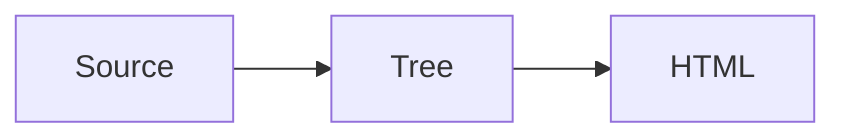

# Cheat Sheet

Every Carve 0.2 construct on one page. Rows marked **✦** need an extension the host turns on; everything else is core syntax. See [Optional Features and Extensions](./extensions) for availability.

`crv` code blocks are valid documents. Where a block shows Rendered and HTML tabs, the HTML is what the 0.2 reference engine writes for that source. [Examples](./examples) shows more complete input and output. Coming from 0.1? [Upgrading from 0.1](./upgrade-0-2) lists every change.

## Inline

### Formatting

| Write | Get | Mnemonic |
| --- | --- | --- |
| `/italic/` | *italic* | slashes lean like italics |
| `*bold*` | **bold** | asterisks are heavy |
| `/*bold italic*/` | ***both*** | combined |
| `{_underline_}` | <u>underline</u> | the line sits below |
| `{~strike~}` | ~~strike~~ | tilde runs through |
| `{^super^}` | super<sup>script</sup> | caret points up |
| `{,sub,}` | sub<sub>script</sub> | commas pull down |
| `{=highlight=}` | <mark>highlight</mark> | like a highlighter pen |
| `` `code` `` | `code` | backticks |
| `` !`/kaet/` `` | /kaet/ | inline literal: verbatim text without code styling |

Bare `_`, `~` and `=` are ordinary characters in 0.2: underline, strike and highlight always use the braced form. Emphasis and strong also have braced forms, `{/x/}` and `{*x*}`, which work inside a word. The braces need content: an empty pair such as `{^^}` is text.

::: compare
```crv
/Emphasis/, *strong*, {_underline_}, {~strike~} and {=highlight=}.
H{,2,}O and mc{^2^}, and a {*bold*}face word.
```

```html
<p><em>Emphasis</em>, <strong>strong</strong>, <u>underline</u>, <s>strike</s> and <mark>highlight</mark>.
H<sub>2</sub>O and mc<sup>2</sup>, and a <strong>bold</strong>face word.</p>
```
:::

### Links, references and extensions

| Write | Get | Notes |
| --- | --- | --- |
| `[text](https://example.com)` | link | |
| `[text][ref]` | reference link | `[ref]: https://example.com` on its own line, anywhere in the document |
| `[Page Name][]` | link to a heading | resolves to the heading with that text |
| `<https://example.com>` | autolink | bare URLs stay text; autolinking them is an extension ✦ |
| `</#section-id>` | cross-reference | link text taken from the target |
| `` | image | |
| `[^1]` and `^[inline note]` | footnote | reference and inline form |
| `[span]{.class}` | span | `{...}` adds a class, id or attributes |
| `:name[content]{attrs}` | inline extension | the syntax is core; a handler is an extension ✦ |
| `@user`, `#tag` | mention, tag | |

::: compare
```crv
= Setup

Read [the guide][guide], jump to [Setup][] or </#Setup>.
A note.[^n] An [important]{.badge} word, @ada and #release.

[guide]: https://example.com/guide

[^n]: The note text.
```

```html
<section id="Setup">
  <h1>Setup</h1>
  <p>Read <a href="https://example.com/guide">the guide</a>, jump to <a href="#Setup">Setup</a> or <a href="#Setup">Setup</a>.
A note.<a id="fnref1" href="#fn1" role="doc-noteref"><sup>1</sup></a> An <span class="badge">important</span> word, <span class="mention"><strong>@ada</strong></span> and <span class="tag"><strong>#release</strong></span>.</p>
</section>
<section role="doc-endnotes" aria-label="Footnotes">
  <hr>
  <ol>
    <li id="fn1">
      <p>The note text.<a href="#fnref1" role="doc-backlink" aria-label="Back to reference">↩</a></p>
    </li>
  </ol>
</section>
```
:::

### Escapes and typography

| Write | Get | Notes |
| --- | --- | --- |
| `\*literal\*` | \*literal\* | backslash before any ASCII punctuation |
| `--` `---` `...` | – — … | dashes and ellipsis |
| `-->` `<--` `==>` `<=>` | → ← ⇒ ⇔ | arrows |
| `!=` `<=` `>=` `+-` `(tm)` | ≠ ≤ ≥ ± ™ | signs |
| `\` at the end of a line | hard break | |
| `\ ` (backslash, space) mid-line | no-break space | |
| `` `<br>`{=html} `` | raw inline | written only when the host allows raw HTML; escaped otherwise |

Every run of two or more hyphens becomes a dash, also in front of a word: write a command-line flag in a code span, `` `--verbose` ``, or escape it, `-\-verbose`. The 0.1 exception for flags and the braced `{--}` are gone. Straight quotes become curly quotes from their neighbors; type the curly character where the guess is wrong. A host can turn smart typography off.

## Blocks

### Headings, breaks and paragraphs

```crv
= Title

== Section

=== Subsection

***

A paragraph runs until a blank line.
Lines join with a space.
```

Headings are `=` to `======`, followed by one space. `#` to `######` also make headings, but a document should use one marker: `carve lint` reports a mix, and `carve fmt` rewrites `#` to `=`. Put attributes for a heading on the line above it, `{#id .class}`. A thematic break is `***`; `---` and `___` are no longer breaks.

Most blocks need a blank line between them. Only a fence line, a table row, a `***` break, a caption after an image or display math, and a marker that continues an open list end a paragraph without one. Put a blank line above a heading, a quote, a description list or an attribute line that follows paragraph text.

### Lists

```crv
- unordered
- items
```

```crv
. auto-numbered
. from 1
```

```crv
3. explicit numbers
4. set the start
```

```crv
a. letter markers
b. lowercase
```

```crv
A.  uppercase markers
B.  need two spaces
```

```crv
{.checklist}
- the attribute line styles the list
- the next item
```

- `. item` numbers the list from 1. Other ordered styles are `a.`, `A.`, `i.` and `I.`, and every style also takes the `)` delimiter. An uppercase letter or Roman marker with a dot needs two spaces after it, `A.  item`, so `A. Smith` and `II. Background` stay text; every other marker needs one.
- The first marker fixes the list style, so `v.` followed by `vi.` starts a second, Roman list.
- A blank line between items makes the list loose. List items take later blocks indented to their content column.

```crv
- step one

  > a note that belongs to step one

- step two
```

`+` lines have no meaning in 0.2: indent a block under the item to attach it.

### Task items

```crv
- [ ] open task
- [_] open, alternative spelling
- [/] in progress
- [!] blocked
- [x] done
- [-] dropped
- [>] deferred
- [?] uncertain
```

Every task state renders a disabled checkbox, checked only for `[x]`. Every state except `[ ]` keeps its character in `data-task-state`.

### Description lists

```crv
:: term
: definition
:: another term
: its definition
```

### Quotes

::: compare
```crv
> The art of being wise is the art of knowing what to overlook.
^ William James
```

```html
<figure>
  <blockquote><p>The art of being wise is the art of knowing what to overlook.</p></blockquote>
  <figcaption>William James</figcaption>
</figure>
```
:::

A `^` line after the quote is its caption and wraps the quote in a figure. To put more than one paragraph or a list in a quote, repeat the `>` on every line, or use the fenced form, which needs no marker per line:

:::: compare
````crv
::: >
Notes:

- a
- b
:::
````

```html
<blockquote>
  <p>Notes:</p>
  <ul>
    <li>a</li>
    <li>b</li>
  </ul>
</blockquote>
```
::::

### Code

````crv
```js "Header" [Label]
const answer = 42
```

```=html
<div>raw HTML, written only when the host allows it</div>
```
````

Write the language directly after the fence. A quoted `"Header"` becomes the `title` of the `<pre>`, and a `[Label]` names the block, for example a tab in a code group. Both are optional and come in that order. Code fences use backticks; `~~~` fences are text in 0.2.

### Divs and admonitions

````crv
::: note "Custom Title"
An admonition.
:::

::: card
Any other word makes a div with that class.
:::

:::: outer
::: tip
A longer fence holds a shorter one.
:::
::::
````

The admonition names are `note`, `tip`, `warning`, `danger`, `info`, `success`, `example` and `quote`; they render as `<aside>`. The title must be in straight double quotes. A closer matches its opener's length, so an outer div uses one more colon than the div inside it.

### Line blocks

:::: compare
````crv
::: |
Roses are red,
  violets are blue.
:::

::: \
one
two
:::
````

```html
<div class="line-block">
  <p>Roses are red,<br>
&nbsp;&nbsp;violets are blue.</p>
</div>
<div class="hardbreaks">
  <p>one<br>
two</p>
</div>
```
::::

`::: |` keeps every line break and leading space, for verse and addresses. `::: \` keeps line breaks only.

## Tables

`|=` marks a header cell: in the first row it heads a column, in a body row it heads that row. Every cell marker is glued to the pipe and followed by a space; that space ends the marker run, so `|=a |` is a data cell whose text is `=a`. A `^` line after the table is its caption.

::: compare
```crv
|= Item |= Qty |
|= Apple | 12 |
| Pear | 3 |
^ Stock on hand
```

```html
<table>
  <caption>Stock on hand</caption>
  <thead>
    <tr><th scope="col">Item</th><th scope="col">Qty</th></tr>
  </thead>
  <tbody>
    <tr><th scope="row">Apple</th><td>12</td></tr>
    <tr><td>Pear</td><td>3</td></tr>
  </tbody>
</table>
```
:::

A cell that holds only `^` merges upward (rowspan), and one that holds only `<` merges leftward (colspan). A `+` row continues the row above it, cell by cell, joined with a space. A GFM separator row such as `|---|` is an ordinary data row in 0.2.

::: compare
```crv
|= Item |= Qty |= Note |
| Apple | 12 | fresh |
+ | | picked today |
| ^ | 3 | < |
```

```html
<table>
  <thead>
    <tr><th scope="col">Item</th><th scope="col">Qty</th><th scope="col">Note</th></tr>
  </thead>
  <tbody>
    <tr><td rowspan="2">Apple</td><td>12</td><td>fresh picked today</td></tr>
    <tr><td colspan="2">3</td></tr>
  </tbody>
</table>
```
:::

### Alignment

`<` left, `~` center, `>` right; `^` top, `~` middle, `v` bottom. Put the symbols in a brace prefix glued to the cell marker, before any other attributes: `|={>}` for a header, `|{> .num} 12.50 |` for a cell. A horizontal symbol may stand alone; a vertical symbol needs a horizontal partner. Use `?` to keep the column's horizontal alignment: `{?^}`, `{?~}` and `{?v}` set only the vertical axis. A header cell's symbols in the first row set the default for its column; a later cell overrides only itself.

::: compare
```crv
|={~} Item |={>^} Qty |
| Apple | 12 |
| Subtotal |{<v} 12 |
| Total |{?v} 15 |
```

```html
<table>
  <thead>
    <tr><th scope="col" style="text-align: center;">Item</th><th scope="col" style="text-align: right; vertical-align: top;">Qty</th></tr>
  </thead>
  <tbody>
    <tr><td style="text-align: center;">Apple</td><td style="text-align: right; vertical-align: top;">12</td></tr>
    <tr><td style="text-align: center;">Subtotal</td><td style="text-align: left; vertical-align: bottom;">12</td></tr>
    <tr><td style="text-align: center;">Total</td><td style="text-align: right; vertical-align: bottom;">15</td></tr>
  </tbody>
</table>
```
:::

`{<v}` overrides both axes for that cell; `{?v}` moves only the vertical one, so the total keeps the column's right alignment.

Attributes on the line above a table set defaults for a table without header cells, `{aligns="right,center" valigns="top,bottom" widths="30,70"}`, and `{header-rows=N footer-rows=N}` sets explicit `thead` and `tfoot` ranges:

::: compare
```crv
{aligns=left,right header-rows=1 footer-rows=1}
| Item | Qty |
| Apple | 12 |
| Total | 12 |
```

```html
<table>
  <thead>
    <tr><td style="text-align: left;">Item</td><td style="text-align: right;">Qty</td></tr>
  </thead>
  <tbody>
    <tr><td style="text-align: left;">Apple</td><td style="text-align: right;">12</td></tr>
  </tbody>
  <tfoot>
    <tr><td style="text-align: left;">Total</td><td style="text-align: right;">12</td></tr>
  </tfoot>
</table>
```
:::

### CSV and TSV data

A `{table}` flag on the line above a `csv` or `tsv` fence makes the fence a table. The first record is the header row. Fields follow RFC 4180 quoting, so a quoted field can hold a comma or a line break, and `""` is a literal quote.

::: compare
````crv
{table}
```csv
Item,Qty,Note
Apple,12,fresh
"Pear, green",3,"picked
today"
```
^ Stock on hand
````

```html
<table>
  <caption>Stock on hand</caption>
  <thead>
    <tr><th scope="col">Item</th><th scope="col">Qty</th><th scope="col">Note</th></tr>
  </thead>
  <tbody>
    <tr><td>Apple</td><td>12</td><td>fresh</td></tr>
    <tr><td>Pear, green</td><td>3</td><td>picked
today</td></tr>
  </tbody>
</table>
```
:::

A `tsv` fence splits on tabs and quotes the same way. The other table attributes work on the same line: `aligns`, `valigns`, `widths`, `footer-rows`, and `header-rows=0` for a table without a header row.

::: compare
````crv
{table aligns=left,right header-rows=0}
```csv
Apple,12
Pear,3
```
````

```html
<table>
  <tbody>
    <tr><td style="text-align: left;">Apple</td><td style="text-align: right;">12</td></tr>
    <tr><td style="text-align: left;">Pear</td><td style="text-align: right;">3</td></tr>
  </tbody>
</table>
```
:::

Fields are literal text: no inline markup, span marks or cell attributes. `carve fmt` keeps the delimited form. Without the `{table}` flag the fence is an ordinary code block. With it, the fence is always a table: a quote that is never closed takes the rest of the body into its cell, and `carve lint` reports `delimited-table-malformed`. A quote inside an unquoted field is ordinary text. The data can also live in its own file: put `{table}` above a code include of the file, as shown in [Include Files](./include-files).

### Aligned source formatting

`carve fmt` writes one space on each side of a cell, whatever the column width. That is the canonical form. `carve fmt --align-tables` pads every cell to its column's width instead:

```crv
|= Name |= Score |= Note |
| Ada | 9 | first try |
| 山田太郎 | 10 | a longer note |
```

becomes

<!-- carve-sample {"fmtSkip":"shows the --align-tables output, which is not the default canonical form"} -->
```crv
|= Name    |= Score |= Note         |
| Ada      | 9      | first try     |
| 山田太郎 | 10     | a longer note |
```

Padding goes after the content, also in right-aligned columns, and wide characters such as CJK count as two columns. Both forms render the same table. `carve fmt --align-tables --check` is the matching CI gate.

## Captions

One `^` line after an image, a quote, a table, a code fence or display math adds a `<figcaption>`. A `#` in the caption is the automatic number, so a cross-reference to the element's id renders as "Figure 1" rather than repeating the caption:

::: compare
```crv
{#fig-sun}

^ Figure #: A sunset

See </#fig-sun> for the view.
```

```html
<figure id="fig-sun">
  
  <figcaption>Figure 1: A sunset</figcaption>
</figure>
<p>See <a href="#fig-sun">Figure 1</a> for the view.</p>
```
:::

A caption after a code fence makes a numbered listing, and after display math a numbered equation. A bare `::: figure` groups captioned images into one figure with its own caption:

:::: compare
````crv
::: figure

^ (a) One


^ (b) Two
:::
^ Figure #: The pair
````

```html
<figure class="carve-figure-group">
  <figure class="carve-figure-panel">
    
    <figcaption>(a) One</figcaption>
  </figure>
  <figure class="carve-figure-panel">
    
    <figcaption>(b) Two</figcaption>
  </figure>
  <figcaption>Figure 1: The pair</figcaption>
</figure>
```
::::

A caption continues on lines indented past its `^`; an unindented line starts the next block:

```crv

^ A long caption that
  continues on the next line.
```

## Attributes and metadata

```crv
{#intro .lead data-note=x}
A paragraph with an id, a class and a data attribute.

A French word: [bonjour]{:fr}.

Press [Tab]{kbd} to accept, [HTML]{abbr="HyperText Markup Language"}, [today]{time=2026-01-01}.

*[CSS]: Cascading Style Sheets

CSS is expanded wherever it appears.
```

- An attribute line attaches to the next block when no blank line separates them. Inline, `{...}` glued to a span, link, image or code span attributes that element.
- `{:fr}` is short for `lang="fr"`, on a span or on the attribute line of a block, and `{:}` marks an unknown language.
- `kbd`, `abbr` and `time` are the core semantic span keys. `samp`, `var`, `cite` and `dfn` need the semantic span extension ✦.
- `*[CSS]: ...` defines an abbreviation for the whole document.

Frontmatter is a `---` block on line 1. Its content is kept raw and renders nothing:

```crv
---
title: My Document
tags: [carve, markup]
---

= My Document
```

Add a format word for another format, `---toml` or `---json`. Later in the document, the same typed openers start a metadata block. See [Metadata Blocks](./metadata-blocks).

## Math, comments and editorial marks

::: compare
```crv
Inline $`e^{i\pi}+1=0`, and display:

$$`\int_0^1 x\,dx`

Visible text %% a line comment to the end of the line
foo  baz

{+inserted+} {-deleted-} {#a visible comment#}
```

```html
<p>Inline <span class="math inline" role="math">\(e^{i\pi}+1=0\)</span>, and display:</p>
<p><span class="math display" role="math">\[\int_0^1 x\,dx\]</span></p>
<p>Visible text
foo  baz</p>
<p><ins>inserted</ins> <del>deleted</del> <span class="critic-comment">a visible comment</span></p>
```
:::

A block comment is a `%%%` fence; everything up to the closing `%%%` is dropped:

```crv
%%%
Not rendered.
%%%
```

`` hides a note from the reader, and `{# ... #}` shows one to the reader. `{+...+}` and `{-...-}` mark insertions and deletions. These need content: an empty pair such as `{++}` is text. The 0.1 substitution form `{~old~>new~}` is gone; `{~...~}` is strike in 0.2.

## Diagrams and charts ✦

Fenced blocks that a drawing library or a build step turns into images. Fence names: `mermaid`, `d2`, `graphviz` (`dot`), `wavedrom`, `abc`, `plantuml` (`puml`), `vega-lite` and `chart`. Mermaid covers the UML `classDiagram`, `sequenceDiagram`, `stateDiagram-v2` and `erDiagram`.

<!-- carve-example {"extensions":["mermaid"]} -->
::: compare
````crv

````

```html
<pre class="mermaid" role="img" aria-label="mermaid">flowchart LR
  Source --> Tree --> HTML</pre>
```
:::

Diagram extensions are off by default; without them the fence is a code block. See [Diagrams and Charts](./diagrams).

## Next

- [Examples](./examples): each construct next to its rendered HTML.
- [Get Started](./get-started): render Carve in your own project.
- [Coming from Markdown](./migrate-from-markdown): what changes for a Markdown author.

**Specification (external):** [block structure](https://github.com/markup-carve/carve/blob/main/spec/0.2/syntax-blocks.md) (headings, lists, tables, captions, attribute lines, frontmatter), [inline content](https://github.com/markup-carve/carve/blob/main/spec/0.2/syntax-inline.md) (emphasis, braced delimiters, links, smart typography C2-I-104 to C2-I-117) and [HTML output](https://github.com/markup-carve/carve/blob/main/spec/0.2/html.md).
