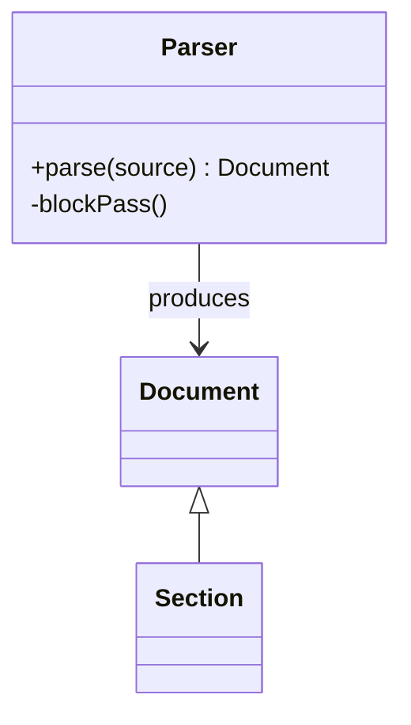
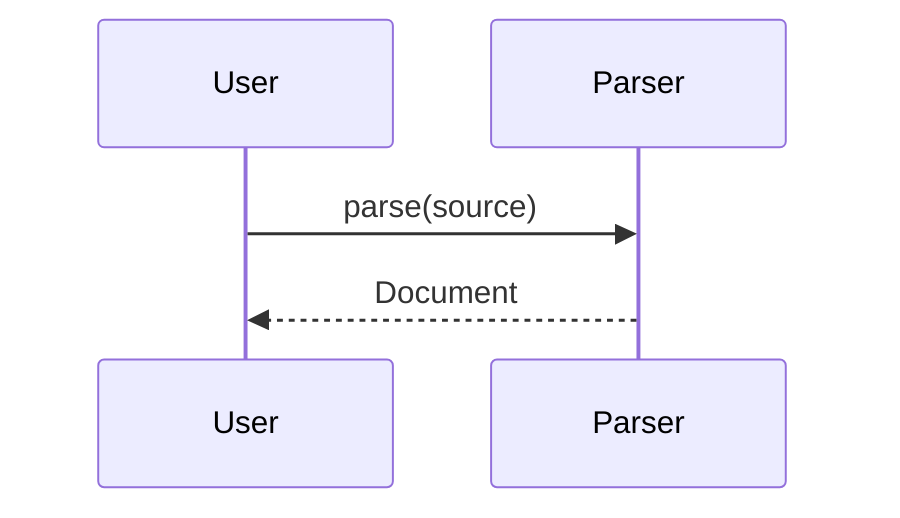
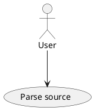
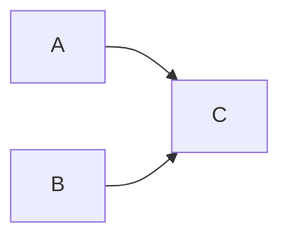
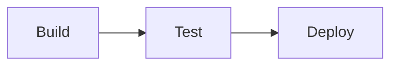
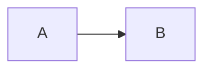

# Diagrams and Charts

Carve stores diagram instructions in fenced code blocks. A host that registers a diagram extension turns the fence into an element that a drawing library or a build step replaces with the finished image. Without the extension the fence is an ordinary code block, so the source is never lost.

<!-- carve-example {"extensions":["mermaid"]} -->
::: compare
````crv

````

```html
<pre class="mermaid" role="img" aria-label="mermaid">classDiagram
  class Parser {
    +parse(source) Document
    -blockPass()
  }
  Parser --> Document : produces
  Document &lt;|-- Section</pre>
```
:::

The examples on this page are rendered live: the Rendered tab draws the diagram, and the HTML tab shows what the engine writes.

## Supported diagram languages

The standard diagram extensions claim these fence names. Each one writes an HTML element for its drawing library.

| Fence name | Draws | Mode |
| --- | --- | --- |
| `mermaid` | flowcharts, UML (class, sequence, state, ER), Gantt, C4 | text |
| `d2` | declarative diagrams, layered layouts | text |
| `graphviz` or `dot` | directed and undirected graphs | text |
| `wavedrom` | digital timing diagrams, register maps | text |
| `abc` | musical notation | text |
| `plantuml` or `puml` | the full UML set (use case, component, deployment, timing) | text |
| `vega-lite` | statistical charts from a grammar-of-graphics spec | json |
| `chart` | Chart.js charts | json |

In JavaScript each name has its own factory in `@markup-carve/carve/extensions` (`mermaid`, `d2`, `graphviz`, `wavedrom`, `abc`, `plantuml`, `vegaLite`, `chart`), and `presets()` registers all of them at once. A host can claim another fence name with `fencedRender({ language, cssClass, contentMode })`.

## UML

Mermaid covers most of UML directly:

| Diagram | Mermaid keyword |
| --- | --- |
| Class | `classDiagram` |
| Sequence | `sequenceDiagram` |
| State | `stateDiagram-v2` |
| Entity relationship | `erDiagram` |
| Activity | `flowchart` or `graph` |

<!-- carve-example {"extensions":["mermaid"]} -->
::: compare
````crv

````

```html
<pre class="mermaid" role="img" aria-label="mermaid">sequenceDiagram
  participant U as User
  participant P as Parser
  U->>P: parse(source)
  P-->>U: Document</pre>
```
:::

Mermaid does not cover use case, component, deployment and timing diagrams. For those, use the `plantuml` fence (also claimed as `puml`), which carries the full UML set. The docs site does not load PlantUML, so this one is shown as source only:

````crv

````

## Charts

The `chart` fence holds a Chart.js configuration as JSON:

<!-- carve-example {"extensions":["chart"]} -->
::: compare
````crv
```chart
{"type":"bar","data":{"labels":["2k","8k","32k"],"datasets":[{"label":"Render time (ms)","data":[1,3,11]}]}}
```
````

```html
<div class="chart" role="img" aria-label="chart"><script type="application/json">{"type":"bar","data":{"labels":["2k","8k","32k"],"datasets":[{"label":"Render time (ms)","data":[1,3,11]}]}}</script></div>
```
:::

## Generated HTML

The extension writes the element shown below. The page must load the library that replaces it with a finished diagram.

*Text mode* (Mermaid, D2, Graphviz, WaveDrom, ABC, PlantUML) writes the fence body inside a `<pre>`. The body is escaped as HTML text: `&` and `<` become entities, and `>` stays as written, so arrow syntax such as `-->` survives intact.

<!-- carve-example {"extensions":["presets"]} -->
::: compare no-render
````crv

````

```html
<pre class="mermaid" role="img" aria-label="mermaid">graph LR
  A &amp; B --> C</pre>
```
:::

*JSON mode* (Vega-Lite, Chart.js) writes the body unchanged inside a JSON script element, which the browser does not run:

<!-- carve-example {"extensions":["presets"]} -->
::: compare no-render
````crv
```vega-lite
{"mark":"bar"}
```
````

```html
<div class="vega-lite" role="img" aria-label="vega-lite"><script type="application/json">{"mark":"bar"}</script></div>
```
:::

## Give a diagram a useful name

Add an `aria-label` on the attribute line above the fence when the fence name alone would not tell a reader what the diagram shows:

<!-- carve-example {"extensions":["mermaid"]} -->
::: compare
````crv
{aria-label="Deployment flow"}

````

```html
<pre class="mermaid" aria-label="Deployment flow" role="img">flowchart LR
  Build --> Test --> Deploy</pre>
```
:::

The generated element carries that label together with `role="img"`. Without one, the extension uses its class name, such as `mermaid`, `graphviz` or `plantuml`. For text formats, the source stays in the labeled element until the drawing library replaces it. A host that wants unnamed fences without an image role or default label configures the extension with `label: ''`.

The label is an HTML attribute. Markdown and plain-text exports keep the diagram source but drop the attributes, so put a description in nearby visible prose when those outputs must explain the drawing. The same holds for an `aria-label` on math: HTML keeps the name, while text outputs show the formula.

## Rendering without a browser

For PDF, email or any output that runs no JavaScript, render in static mode and give the extension a build-time renderer. The renderer receives the diagram source and returns self-contained HTML, usually an `<svg>` or an `` with a `data:` URI:

```js
import { render } from '@markup-carve/carve'
import { mermaid, withExtensions } from '@markup-carve/carve/extensions'

const html = render(source, {
  mode: 'static',
  ...withExtensions(mermaid({ build: (diagram) => drawMermaidToSvg(diagram) })),
})
```

`drawMermaidToSvg` stands for your own build step, for example a call to the Mermaid CLI. If you sanitize the result, allow `data:` image URLs, or the sanitizer removes the diagram. Per-engine recipes are in [Static Rendering Recipes](./static-rendering-recipes).

## Seeing it rendered

The Rendered tabs on this page draw their diagrams with Mermaid and Chart.js in your browser. To try your own:

- [Playground](./playground): paste a `mermaid` or `chart` fence and the browser draws it.
- [carve-pdf `03-math-diagrams.pdf`](https://github.com/markup-carve/carve-pdf/blob/master/examples/03-math-diagrams.pdf): a PDF built from [`03-math-diagrams.crv`](https://github.com/markup-carve/carve-pdf/blob/master/examples/03-math-diagrams.crv), with Mermaid flowcharts, KaTeX math and a Chart.js chart drawn at print time. That example uses the released 0.1 engine.

## When a diagram cannot be drawn

The fallback depends on how the document is rendered:

- With the extension off, the fence is an ordinary code block with its language class.
- In browser output, text formats keep their source in the labeled element until a drawing library replaces it. JSON formats keep their data in the page, but no chart appears without the library.
- In static output, a fence whose extension has no build-time renderer becomes the plain code block. It has no image role and no name from the extension.

<!-- carve-example {"options":{"mode":"static"},"extensions":["mermaid"]} -->
::: compare no-render
````crv

````

```html
<pre><code class="language-mermaid">flowchart LR
  A --&gt; B
</code></pre>
```
:::

The diagram never disappears silently, and its source stays in the document. See [Output without JavaScript](./graceful-degradation) for every output format.

## Enabling

Diagram extensions are off by default. A host registers the ones it wants and passes them to the render call:

```js
import { render } from '@markup-carve/carve'
import { chart, mermaid, withExtensions } from '@markup-carve/carve/extensions'

const html = render(source, withExtensions(mermaid(), chart()))
```

The page that shows the HTML must also load Mermaid, Chart.js or whichever library draws the fences you enabled. See [Optional Features and Extensions](./extensions) and the extension documentation of your engine.

**Specification (external):** [Extensions](https://github.com/markup-carve/carve/blob/main/spec/0.2/extensions.md) (registration and rendering modes, C2-X-050 to C2-X-052; diagram extensions, C2-X-061 and C2-X-071) and [HTML output](https://github.com/markup-carve/carve/blob/main/spec/0.2/html.md).
