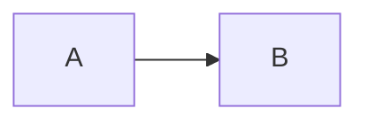

# Diagrams and Charts

A code fence can carry diagram source for a host extension. Core Carve 0.2 renders it as code. A host that registers an extension may transform the code block and render a diagram; the fallback remains valid core content. See the [0.2 extension contract](https://github.com/markup-carve/carve/blob/next2/spec/0.2/extensions.md#registration-and-matching).

````crv

````

Give a diagram a description in nearby prose. If the host renders it as an image, provide accessible text through the host's extension output. The language name alone does not promise a browser renderer or a bundled diagram library.

For portable documents, keep essential information in text or a table. The extension contract describes how transformed nodes retain a core fallback and how hosts select trusted renderers. See [extensions](https://github.com/markup-carve/carve/blob/next2/spec/0.2/extensions.md) and [HTML output](https://github.com/markup-carve/carve/blob/next2/spec/0.2/html.md).
