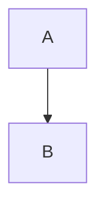

# Extension contract

This page is for people who build Carve hosts, engines and extensions. It explains what an extension may claim, what it must put in the tree, how a host renders and writes extension nodes, and how each standard extension behaves. The reader-facing overview is [Optional features and extensions](/extensions); a runnable inline example is in [Write an extension](/extension-tutorial).

The extension interface and the standard extension catalog are provisional in Carve 0.2. The core syntax is frozen; the extension clauses may still change in a 0.2.x release. Pin the specification revision and the engine version you build against.

Every HTML sample on this page is real output of the pinned `carve-js` engine. Where a sample needs a standard extension, the line between the source and the output names the `npx carve render` flags that produce it, so you can run it yourself.

::: tip Example
To build an extension of your own in JavaScript, start with [Write an extension](/extension-tutorial), then come back here for the rules a host has to follow.
:::

## 1. Core, standard extensions and host extensions

Carve 0.2 has three kinds of behavior:

| Kind | What it is | Default | Who defines it |
| --- | --- | --- | --- |
| Core | the syntax and HTML of the core specification | always on | the specification |
| Standard extension | a named, versioned behavior from the standard catalog, such as `carve.tabs` | off; a host registers it | the specification catalog (provisional) |
| Host extension | a behavior a host defines under its own qualified name, such as `org.example.aside` | off; only that host has it | the host |

The 0.1 names Tier 1, Tier 2 and Tier 3 are gone. In 0.1 a tier said which engines shipped a feature. In 0.2 the line is simpler: core behavior is the same everywhere, and every extension, standard or not, is something a host turns on.

An extension never adds syntax. It claims a node that core parsing already built: an inline `:name[content]`, a named div, or a fenced code block. A document that uses an extension therefore parses the same way with or without it, and a reader without the extension still gets readable output.

### Standard catalog (quick reference) {#feature-tiers-quick-reference}

These are the standard extensions of the provisional catalog. "Claims" is the core node the matcher takes. "Transform" means the extension has no matcher and changes the document or the core renderer instead. `npx carve render --extensions '["NAME"]'` registers any of them with its standard renderer.

| Extension | Claims | What it writes |
| --- | --- | --- |
| `carve.tabs`, `carve.tab` | div `tabs` holding `tab` divs | radio tabs, ARIA tabs, or static sections (section 13) |
| `carve.codeGroup` | div `code-group` holding code blocks | tabbed code blocks (section 13) |
| `carve.details` | div `details` | `<details>` disclosure (section 14) |
| `carve.spoiler`, `carve.spoilerBlock` | inline `:spoiler[...]`, div `spoiler` | hidden-content marker (section 14) |
| `carve.listTable` | div `list-table` | an HTML table from nested lists (section 5) |
| `carve.cite` | inline `:cite[...]` | citations and a reference list (section 4) |
| `carve.glossary`, `carve.term` | transform; inline `:term[...]` | linked glossary terms (section 7) |
| `carve.index`, `carve.indexTerm` | transform; inline `:index[...]` | back-of-book index (section 8) |
| `carve.toc`, `carve.tocPlacement` | transforms | table of contents (section 8b) |
| `carve.headingNumbers` | transform | section numbers and numbered cross-references (section 9) |
| `carve.codeCallouts` | transform | callout marks in code (section 10) |
| `carve.semanticSpan` | transform | `samp`, `var`, `cite`, `dfn` span keys (section 11) |
| `carve.wiki` | inline `:wiki[...]` | site-internal page links (section 12) |
| `carve.headingReference` | transform | a class on links a heading resolves (section 12) |
| `carve.fencedRender.*` | fences `mermaid`, `d2`, `dot`, `graphviz`, `plantuml`, `puml`, `wavedrom`, `abc`, `chart`, `vega-lite` | client-rendered diagrams (section 14) |
| `carve.mathBlock` | fence `math` | display math (section 14) |
| `carve.imgFence.img`, `carve.imgFence.image` | fences `img`, `image` | sanitized SVG as an `` (section 14) |
| `carve.colorSwatch` | inline `:color[...]` | a color chip (section 14) |
| `carve.autolink`, `carve.externalLinks` | transforms | bare URL links, external link attributes (section 14) |
| `carve.headingPermalinks` | transform | a `¶` link on each heading (section 14) |
| `carve.tabNormalize` | transform | tabs in code replaced by spaces (section 14) |
| `carve.smartQuotes` | transform | locale quote glyphs (section 14) |

The catalog lives in `data/extensions.json` in the specification repository. Each row gives the name, the version (`1` for all of them today), the matcher, the slots and, where there is one, the renderer option a host may set.

### A name nobody claims stays core

When no registered matcher claims a source form, the parser's core node is what renders. This is the floor every extension falls back to, and it is the same in every engine. A `:name[...]` becomes a `<span class="ext-NAME">`; a named div becomes a `<div>` with the name as its class; a fence stays a code block.

```crv
The killer is :spoiler[the butler].

::: spoiler
The butler did it.
:::
```

```html
<p>The killer is <span class="ext-spoiler">the butler</span>.</p>
<div class="spoiler">
  <p>The butler did it.</p>
</div>
```

Nothing is lost: the text is visible and both elements keep a class a stylesheet can hook. Registering the extension changes only the output, not the parse.

### Mention and tag link resolvers

Mentions (`@name`) and tags (`#name`) are core syntax. How they link is a render option, `social`, not an extension. Without it both render as inert spans.

URL templates cover deterministic routes. Each `{name}` is replaced by the percent-encoded name:

```js
render(source, { social: { mentionUrl: '/users/{name}', tagUrl: '/topics/{name}' } })
```

A host that needs aliases, database ids, tenant routing or access control configures a resolver instead. A resolver receives the parsed name and the host's `context` value, and returns a complete destination or `null`:

```js
import { render } from '@markup-carve/carve'

const context = {
  users: new Map([['alice', '/people/42']]),
  topics: new Map([['release', '/collections/stable']]),
}

const html = render('Known @alice and #release; unknown @missing.', {
  social: {
    context,
    resolveMention: ({ name, context }) => context.users.get(name) ?? null,
    resolveTag: ({ name, context }) => context.topics.get(name) ?? null,
  },
})
```

The two known names link and the missing user stays inert:

```html
<p>Known <a class="mention" href="/people/42">@alice</a> and <a class="tag" href="/collections/stable">#release</a>; unknown <span class="mention"><strong>@missing</strong></span>.</p>
```

The resolver controls only the destination. It cannot change the label, add attributes or return HTML, so `@alice` stays the visible text. A resolver for a kind takes precedence over that kind's template, and an unresolved result does not fall through to the template, so an authoritative lookup can reject a deleted user. A template's placeholder is percent-encoded; a resolver's result is used as returned. Both pass the URL policy: a resolver that returns `javascript:alert(1)` gets `href=""`. Carve passes `context` through without reading it, and a host that does I/O in a resolver owns its timeouts and authorization. On the command line, `--social` takes the templates as JSON; resolvers are functions and exist only in the library.

### Footnotes are core

Reference footnotes `[^id]` and inline footnotes `^[content]` are core, and so is the `::: footnotes` directive that places the footnote section (section 8b). The sidenote form `[>content]` proposed in 0.1 was dismissed, not deferred: margin placement is CSS over the footnote output.

### 1.5 The strings an extension writes itself

Almost every string in the output comes from the document. A few come from the engine: the name of a tab set, the name of a table of contents, the leading words of an index back-link. The render option `labels` replaces these engine-written strings, and one map covers the core strings and the extension strings together. A host translating a site sets it once.

The keys an extension reads:

| Key | Default | Read by |
| --- | --- | --- |
| `tabsGroup` | `Tabs` | the tabs renderer, as the `aria-label` of the tab set |
| `codeGroup` | `Code examples` | the code-group renderer, as the `aria-label` of the group |
| `tocNav` | `Table of contents` | the `carve.toc` and `carve.tocPlacement` renderers, as the `aria-label` of the `<nav>` |
| `indexBackref` | `Back to` | nothing directly; it is the default of the index option `backrefLabel` |

A German site renames the tab set:

```crv
:::: tabs
::: tab "Install"
Run setup.
:::
::::
```

With `--extensions '["carve.tabs"]' --labels '{"tabsGroup":"Registerkarten"}'`:

```html
<div class="tabs" role="group" aria-label="Registerkarten"><input type="radio" name="tabs-1" id="tabs-1-0" checked><label for="tabs-1-0">Install</label><div class="tab-panel" role="group" aria-label="Install"><p>Run setup.</p></div></div>
```

**Precedence.** A name the author wrote wins, then an option of the extension, then the `labels` map, then the English default. An `aria-label` written on the tab set's attribute line replaces the generated name, because a name in the document is already in the document's language. Naming two tab sets on one page apart is the author's job.

**Index back-links read an option, not the map.** The index is built by a document transform, and a document transform does not see the render options. So `labels.indexBackref` does not reach the index; set `index({ backrefLabel: 'Zurück zu' })` in the library instead. Its default is the default of `indexBackref`, `Back to`. This is a change from 0.1, where the map reached the index.

**Strings with no key.** A string the author already wrote gets no key, because a translated document translates it once, in the document. A tab's quoted title names its panel; an index term names its entry. A string that an extension exposes as its own option gets no key either: the heading permalink label is `headingPermalinks({ ariaLabel })` and the collapsible table of contents summary is `tableOfContents({ summary })`.

There is no locale name and no built-in translation table. A host that needs translated strings already has a catalog; `labels` is where it plugs in.

## 2. Extension system

An extension is a definition with a qualified name and a version. It may contribute a matcher with a transform, a document transform, and renderers. They run in this order:

```text
core parse
  -> claim: each matcher claims an existing core node, its transform builds the extension node
  -> resolution: ids, references, footnotes
  -> document transforms, in registration order, on a copy of the resolved view
  -> render: core HTML plus the registered extension renderers
```

The Carve writer reads the tree before the document transforms, so they never change what `fmt` writes.

### 2.1 Matchers: claim an existing core node

0.1 matchers were scanner functions that read source text at a position and could add syntax. 0.2 has no scanner hook. A matcher names one core form and one name, and claims a node only after core parsing has finished:

| Matcher form | Claims | The transform receives |
| --- | --- | --- |
| `inline` | `:name[content]{attributes}` | the name, the parsed inline children, the attributes |
| `div` | a div opened with `::: name` | the name, the quoted title, the bracket label, the attributes, the parsed body blocks |
| `fence` | a code block whose language is `name` | the language, the title, the bracket label, the attributes, the code text |

In `carve-js` the definition spells this as `matcher: { form: 'div', name: 'aside' }`, and the transform receives an `ExtensionClaim` object with the fields above plus the core `node` and a prepared `source` record.

Rules a matcher author relies on:

- **No new syntax.** A matcher cannot add a sigil, a line shape or a delimiter. Every claimed form is something core already parses.
- **One claim per node.** Two enabled matchers that claim the same form and name fail at registration, before parsing. In `carve-js` the error reads `option extensions: duplicate claim div:box`.
- **Declining is allowed.** A transform that returns `null` leaves the core node in place. The standard tabs matcher does this for a `tabs` div whose body holds anything but titled `tab` divs.
- **Determinism.** A transform gives the same node for the same claimed node, extension version and configuration. Allocate counters and ids in the renderer or a document transform, not in a transform.

The 0.1 rules about matcher purity under speculative calls and about local line coordinates no longer apply: a matcher no longer sees source lines at all.

A tab set that does not meet the claim condition stays core, with the extension registered.

```crv
:::: tabs
::: tab "A"
x
:::

Stray paragraph.
::::
```

With `--extensions '["carve.tabs"]'`:

```html
<div class="tabs">
  <div class="tab">
    <p class="admonition-title">A</p>
    <p>x</p>
  </div>
  <p>Stray paragraph.</p>
</div>
```

### 2.2 Transforms

There are two kinds of transform.

**A claim transform** maps one claimed core node to one extension node of the same role, inline or block. It reads only the claimed node and its descendants and leaves every other node alone. It may put further extension nodes of its own into the slots of the node it returns, as the tabs transform puts each `carve.tab` into the `tabs` slot of `carve.tabs`.

The node it returns must carry:

- the declared qualified `name` and the same `version` as the declaration;
- `props`, a JSON object whose keys the extension's schema defines;
- `slots`, named child lists, each one a declared slot;
- `fallback`, core content of the same role that contains no extension node;
- optionally `payload` and a `source` record (section "Writing back").

The engine copies the claimed node's attributes onto the extension node, so a transform does not have to.

**A document transform** sees the whole document. After includes and ordinary resolution, and before HTML rendering, each registered document transform receives a copy of the resolved render view and returns a view. Registration order is execution order. A document transform may insert or replace nodes of its own extension, claim an existing directive such as `::: toc`, and edit core nodes of the view, as heading numbers do. It does not change the authored tree or what the writer writes.

After each document transform the host checks the result: an inserted or replaced node may not reuse an authored id that an earlier node already has, a directive may be claimed only once (the first registered transform owns it), and inserted extension nodes need their declaration, valid slots and a core fallback. A transform that fails these checks leaves its input view intact and reports a diagnostic naming the extension. Generated ids, heading ids included, are then allocated again over the final view, and references resolve against those final ids.

In `carve-js` a definition carries its document transform as `documentTransform`. A standard bundle whose transform depends on directive claims returns it in a separate `transforms` list, which goes to `renderWithDocumentTransforms` (the `citations` and `index` bundles do this). Passing such a bundle to plain `render` registers the claims but never runs the transform: the citations then render as their fallback text and the `::: references` div stays empty.

**What replaced the 0.1 `beforeRender` context.** In 0.1 a `beforeRender` hook got a read-only context with the render options and the effective mode. A 0.2 document transform gets the view and nothing else. It cannot read `labels`, the URL policy or the mode, and so it cannot weaken them. An extension that needs a setting takes it as its own option, as `index({ backrefLabel })` does, and anything that depends on the mode belongs in the renderer, which receives the mode.

### 2.3 Renderers

A renderer is registered by qualified name and version and receives the extension node and a host object. The `carve-js` host object (`ExtensionRenderHost`) offers:

| Member | Use |
| --- | --- |
| `blocks(nodes, depth?)` | render block children as the core writes them at that depth |
| `inlines(nodes)` | render inline children |
| `plainText(nodes)` | the plain text of nodes, for an accessible name |
| `escapeText(value)`, `escapeAttribute(value)` | escape a string for text or an attribute value |
| `attributes(node, { block?, bare?, style? })` | the node's authored attributes in core order, each with a leading space; `block: true` adds `data-source-line` when that option is on |
| `nextId(prefix)` | a generated id that collides with no other id in the document |
| `labels`, `profile`, `mode`, `urlPolicy`, `sourceLines`, `blockDepth` | the render settings |

A renderer returns an HTML string, and the host writes it unchanged. That makes every renderer trusted host code: the URL policy and the profile apply only through the helpers, never to the returned string. A renderer that returns `<b onclick="x">` has it written as returned, even under the `comment` profile. A host that renders untrusted documents registers only renderers it trusts and builds every dynamic part with the helpers.

Failures stay inside the engine:

| What fails | What renders | Diagnostic |
| --- | --- | --- |
| a transform throws | the claimed core node | `extension-transform-failed` |
| the engine cannot prepare the source record | the claimed core node | `extension-transform-failed` |
| a renderer throws or returns no string | the fallback, unresolved | `extension-renderer-failed` and `extension-fallback-rendered` |
| no renderer matches the name and version in the selected mode | the fallback | `extension-fallback-rendered` |
| a transform returns a node that does not validate | the claimed core node | `extension-fallback-rendered`, with the message `Invalid transform of NAME; the core source node was retained` |

"Unresolved" means that references, footnote references and cross-references inside that fallback render as plain text and its headings get no generated id, because resolution already visited the slots instead.

A renderer registered for another version does not match: `{ version: '2' }` for a node of version `1` renders the fallback.

### 2.4 Registration and configuration

In the `carve-js` library a host passes definitions in `extensions` and renderers in `renderers`, keyed by qualified name. The standard extensions come from `@markup-carve/carve/extensions` as bundles of both:

```js
import { render } from '@markup-carve/carve'
import { details, withExtensions, wikilinks } from '@markup-carve/carve/extensions'

const bundle = withExtensions(details(), wikilinks())
render(source, { extensions: bundle.extensions, renderers: bundle.renderers })
```

`withExtensions` merges bundles and fails when two of them claim the same node.

On the command line `--extensions` takes a JSON list of standard extension names and registers each with its standard renderer; `--extension-options` takes their renderer options keyed by name. Host extensions are code and exist only in the library.

```sh
npx carve render --extensions '["carve.tabs"]' --extension-options '{"carve.tabs":{"mode":"aria"}}' page.crv
```

A name that is not in the catalog, an option an extension does not have, and a value outside an option's list are refused with a usage error, for example `carve.index has no option backrefLabel` and `bad value for the option mode of carve.tabs`. A renderer option is never guessed.

### Worked example: a host block extension

This host extension claims `::: aside` and renders an `<aside>`. It keeps the quoted title in a slot and gives readers without the extension the same fallback shape the standard tabs use: the title as a strong paragraph, then the body.

```js
import { render, renderWithDiagnostics } from '@markup-carve/carve'

const aside = {
  name: 'org.example.aside',
  version: '1',
  matcher: { form: 'div', name: 'aside' },
  props: {},
  slots: { title: { kind: 'inline', optional: true }, body: { kind: 'block' } },
  transform(claim) {
    if (claim.form !== 'div') return null
    const title = claim.node.title
    const heading = title ? [{ type: 'paragraph', children: [{ type: 'strong', children: structuredClone(title) }] }] : []
    return {
      type: 'block_extension',
      name: 'org.example.aside',
      version: '1',
      children: [],
      slots: title ? { title, body: claim.body } : { body: claim.body },
      fallback: [...heading, ...structuredClone(claim.body)],
      source: claim.source,
    }
  },
}

const asideRenderer = {
  version: '1',
  render(node, host) {
    const title = node.slots.title ? `<header>${host.inlines(node.slots.title)}</header>` : ''
    return `<aside${host.attributes(node, { block: true })}>${title}${host.blocks(node.slots.body)}</aside>`
  },
}

const source = '{#tip}\n::: aside "Before you start"\nBack up your *data*.\n:::\n'
const options = { extensions: [aside], renderers: { 'org.example.aside': asideRenderer } }

console.log(render(source, options))
const fallback = renderWithDiagnostics(source, { ...options, mode: 'static' })
console.log(fallback.html)
console.log(fallback.diagnostics.map((entry) => entry.code))
```

The document:

```crv
{#tip}
::: aside "Before you start"
Back up your *data*.
:::
```

The program prints:

```html
<aside id="tip"><header>Before you start</header><p>Back up your <strong>data</strong>.</p></aside>
<div id="tip">
  <p><strong>Before you start</strong></p>
  <p>Back up your <strong>data</strong>.</p>
</div>
[ 'extension-fallback-rendered' ]
```

The second render is in static mode, and the renderer has no `buildTime` method, so the fallback renders (section 2.5). The fallback carries an id, so the host wraps it in a `<div>` that holds the attributes; a fallback of a node without attributes adds no element. The class `aside` that core gives the div does not appear: the class a div takes from its name is not an attribute of the extension node. Without the extension registered at all, the same source renders as core:

```html
<div id="tip" class="aside">
  <p class="admonition-title">Before you start</p>
  <p>Back up your <strong>data</strong>.</p>
</div>
```

### The tree: declarations and extension nodes

A tree that holds a qualified extension node declares the extension on its root (or on the envelope at a storage boundary). The declaration gives the name, the version, whether a reader must implement it (`required`), and the ordered list of slot names.

`npx carve ast --extensions '["carve.details"]'` for this source:

```crv
{#more}
::: details "More"
Hidden text.
:::
```

gives the tree below. The position objects are replaced by `"..."` here to keep it short; everything else is the engine's output.

```json
{
  "astVersion": "2.0",
  "children": [
    {
      "attrs": {
        "id": "more"
      },
      "children": [],
      "fallback": [
        {
          "children": [
            {
              "children": [
                {
                  "pos": "...",
                  "type": "text",
                  "value": "More"
                }
              ],
              "type": "strong"
            }
          ],
          "type": "paragraph"
        },
        {
          "children": [
            {
              "pos": "...",
              "type": "text",
              "value": "Hidden text."
            }
          ],
          "pos": "...",
          "type": "paragraph"
        }
      ],
      "name": "carve.details",
      "pos": "...",
      "slots": {
        "body": [
          {
            "children": [
              {
                "pos": "...",
                "type": "text",
                "value": "Hidden text."
              }
            ],
            "pos": "...",
            "type": "paragraph"
          }
        ],
        "title": [
          {
            "pos": "...",
            "type": "text",
            "value": "More"
          }
        ]
      },
      "source": {
        "body": "Hidden text.\n",
        "form": "div",
        "name": "details",
        "title": "More"
      },
      "type": "block_extension",
      "version": "1"
    }
  ],
  "extensions": [
    {
      "name": "carve.details",
      "required": false,
      "slots": [
        "title",
        "body"
      ],
      "version": "1"
    }
  ],
  "srcByteLength": 44,
  "stages": [
    "referenceResolution",
    "tableAlignment"
  ],
  "type": "document"
}
```

What to read from it:

- `children` is empty; the content is in the slots `title` and `body`, which a walker visits in the order of the declaration's `slots` list. A walker needs no registry for that.
- `fallback` is plain core content: the title as a strong paragraph, then the body.
- `attrs` sits on the extension node, not on the fallback, so a host writes the id once.
- `source` records the claimed form (`div`), the name (`details`), the title and the canonical body text, so a writer can spell the div again.

An inline extension that no matcher claims is also an `inline_extension`, but an unqualified one: `:kbd[Ctrl]` gives `"name": "kbd"` with its children as the fallback, needs no declaration and may carry no other field.

Hosts and readers enforce these limits: at most 8 MiB of decoded payload per extension node, at most 8 MiB of `source.body`, and at most 32 levels of extension nesting through slots and children.

### Reading a tree with an extension you do not have

A reader decides by the declaration:

| Declaration | Reader implements it | Reader does not |
| --- | --- | --- |
| `"required": false` | renders through its renderer | keeps the declaration and renders the fallback |
| `"required": true` | renders through its renderer | refuses the tree |

Rendering the details tree above without the extension (`npx carve render --from-ast`) gives the fallback, inside a `<div>` for the id, and the warning `extension-fallback-rendered`:

```html
<div id="more">
  <p><strong>More</strong></p>
  <p>Hidden text.</p>
</div>
```

With `"required": true` in the declaration, the same command stops with `carve[ast-json-invalid]: /extensions/0: an unknown required extension`.

### Writing back

The Carve writer (`fmt`, and `write` for a tree) uses the `source` record. With it, the writer spells the claimed form again, `:name[body]`, a colon-run div or a fenced block, and writes the node's attributes in the core attribute form. `npx carve fmt --from-ast` on the details tree writes the source it came from:

```crv
{#more}
::: details "More"
Hidden text.
:::
```

This works without the extension: the written text reads back as a core div, and a reader with the extension claims it again. Without a source record the writer writes the fallback and reports `structure-unspellable` at the node. The library call `writeWithDiagnostics` returns that text with the diagnostic; `write` and the `carve fmt` command treat the loss as a refusal and throw or exit with an error.

A writer that has the extension registered also checks that the source record parses and transforms back to an equal node. When it does not, it writes the fallback and reports `structure-unspellable`.

### 2.5 Static rendering mode

The render option `mode` is `interactive` (the default) or `static`. Static output is for a medium that runs no script: print, PDF, archives, mail. Any other value is refused.

Each extension renderer has two channels. In `carve-js` they are the `render` and `buildTime` methods of the renderer:

- In `interactive` mode, `render` handles the node.
- In `static` mode, only `buildTime` handles it. A renderer with `render` alone does not count, and the node renders its fallback with `extension-fallback-rendered`.

This replaces the 0.1 resolution order, where a missing `renderStatic` fell back to the interactive renderer and then to a caption floor. In 0.2 there is no step in between: build-time renderer or fallback. A build-time renderer returns self-contained HTML and receives the same host helpers.

What the standard extensions write in static mode (`--mode static`):

| Extension | Static output |
| --- | --- |
| tabs, code group | one `<section>` per panel, headed by an `<h3>` with the tab label; no input, no label element, no id |
| details | `<details open>` |
| spoiler | the content with the class `spoiler-revealed`; a block becomes a `<section>` with an `<h3 class="spoiler-title">` |
| table of contents | the same `<nav>` as in interactive mode |
| diagrams, math block | the output of the host's build function, or the fallback code block |
| color swatch, wiki links | the same output as in interactive mode |

The tab set from section 13 in static mode:

```crv
:::: tabs
::: tab "Install"
Run setup.
:::

::: tab "Use"
Open the app.
:::
::::
```

With `--extensions '["carve.tabs"]' --mode static`:

```html
<div class="tabs" role="group" aria-label="Tabs"><section class="tabs-panel"><h3 class="tabs-label">Install</h3><p>Run setup.</p></section><section class="tabs-panel"><h3 class="tabs-label">Use</h3><p>Open the app.</p></section></div>
```

**Diagrams need a build function.** The engine makes no network call and runs no diagram tool. A diagram extension has a build-time channel only when the host gives it a `build` function, which takes the fence body and returns HTML. Run slow or asynchronous tools (a Mermaid CLI, a rendering service) in a build step and hand the results in as a lookup; the function itself is synchronous:

```js
import { render } from '@markup-carve/carve'
import { mermaid } from '@markup-carve/carve/extensions'

// Filled by a build step that ran the Mermaid CLI over every diagram.
const prerendered = new Map([['graph TD; A-->B', '<svg viewBox="0 0 80 40"></svg>']])
const diagrams = mermaid({ build: (source) => prerendered.get(source) })
render('```mermaid\ngraph TD; A-->B\n```\n', { ...diagrams, mode: 'static' })
```

The build function receives the fence body without its last line break. Its output is wrapped in an element with the fence's class and accessible name:

```html
<div class="mermaid" role="img" aria-label="mermaid"><svg viewBox="0 0 80 40"></svg></div>
```

Without one, static mode writes the fallback, the plain code block, and reports the loss.

````crv
{#flow .wide}

````

With `--extensions '["carve.fencedRender.mermaid"]' --mode static`:

```html
<div id="flow" class="wide">
  <pre><code class="language-mermaid">graph TD; A--&gt;B
</code></pre>
</div>
```

0.1 wrote a `<pre class="mermaid">` source element in static mode; 0.2 writes the core code block instead. `mathBlock({ build })` works the same way, with a second argument that says whether the math is display math. A build function often returns a `data:` image URL; a sanitizer that runs after Carve must allow `data:` for images or the image disappears. Tested recipes are in [Static rendering recipes](/static-rendering-recipes).

The Markdown, plain-text and ANSI targets have no static channel; `mode` is an HTML option.

### 2.6 Generated ids share the document id namespace

Some extensions write ids the tree does not carry: tabs (`tabs-N-K`), code groups (`codegroup-N-tab-K`), citations (`ref-KEY`, and `cite-KEY-N` when a bibliography pool is given), glossary terms (`gloss-TERM`) and index terms (`idx-TERM-N`). These ids live in the same namespace as authored ids and heading ids.

For tabs the rule is exact. Tab sets are counted in document order from 1; set N writes the input name `tabs-N` and the ids `tabs-N-0`, `tabs-N-1` and so on. When an authored id or a generated heading id equals one of a set's ids, that set takes the next N whose ids are all free, and later sets count on from there. Code groups count separately.

```crv
{#tabs-1-0}
A paragraph.

:::: tabs
::: tab "A"
x
:::
::::

:::: tabs
::: tab "B"
y
:::
::::
```

With `--extensions '["carve.tabs"]'`:

```html
<p id="tabs-1-0">A paragraph.</p>
<div class="tabs" role="group" aria-label="Tabs"><input type="radio" name="tabs-2" id="tabs-2-0" checked><label for="tabs-2-0">A</label><div class="tab-panel" role="group" aria-label="A"><p>x</p></div></div>
<div class="tabs" role="group" aria-label="Tabs"><input type="radio" name="tabs-3" id="tabs-3-0" checked><label for="tabs-3-0">B</label><div class="tab-panel" role="group" aria-label="B"><p>y</p></div></div>
```

While any extension that generates ids is registered, the lint rule `broken-fragment-link` reports nothing, because a link may point at an id that only the rendered HTML holds. Host extensions count as generating ids, since the engine cannot read the HTML they return.

### Profiles and the URL policy

A profile decides per node type. An extension node outside the profile renders its degraded form, the plain text of its fallback, with `profile-construct-degraded`. Under `--profile comment` the details example renders:

```html
<p>More</p>
<p>Hidden text.</p>
```

Every profile restriction and every URL policy check also applies inside slots and the fallback. They do not apply to the string a renderer returns, which is why a renderer has to build its output with the host helpers (section 2.3).

### Edge cases a host hits

**A block extension whose content holds an inline extension is not claimed.** In the pinned `carve-js`, a `tabs`, `details`, `spoiler` or `list-table` div whose body contains any `:name[...]`, a claimed `:wiki[...]` or an unclaimed `:foo[...]`, stays the core div, with the warning `Invalid transform of carve.details; the core source node was retained`.

```crv
::: details "X"
Y :wiki[Z].
:::
```

With `--extensions '["carve.details","carve.wiki"]'`:

```html
<div class="details">
  <p class="admonition-title">X</p>
  <p>Y <a href="z" class="wikilink" data-wikilink="Z">Z</a>.</p>
</div>
```

The wiki link still renders, because it is claimed on its own; only the disclosure is lost. Keep inline extensions out of block extensions until the engine changes, or check the diagnostics.

**A bundle with `transforms` needs `renderWithDocumentTransforms`.** Plain `render` with the `citations` or `index` bundle registers the claims but runs no document transform, so citations render as their key text and the directive as an empty div, with no diagnostic that says why.

**Static mode needs `buildTime`.** A renderer with only `render` writes the fallback in static mode (section 2.5). Test both modes for every extension you ship.

**Versions match exactly.** A renderer for version `2` does not render a node of version `1`, and a tree whose declaration names a version the reader does not implement is refused if the extension is required.

**The command line reads a required extension as unknown.** `npx carve render --from-ast --extensions '["carve.wiki"]'` still refuses a tree that declares `carve.wiki` with `"required": true`. The library call `decodeTree(json, { extensions })` with the same extension accepts it.

## 3. Conformance

The standard extensions have their own case file in the specification repository, `spec/0.2/conformance/extensions.json`: each case gives an input, the extensions and renderer options it registers, and the expected HTML. The readiness runner reports it in a section of its own, and it does not gate core conformance. A host extension has no shared cases; it is tested by its host.

Because the catalog is provisional, a case can change in a 0.2.x release. The interface clauses (registration, transformation, rendering, writing) are on the same provisional footing.

## 4. Citations

`carve.cite` claims `:cite[key]`. The key is the citation's fallback text, so a reader without the extension sees the key. A locator is an attribute, not punctuation inside the key, and several keys are separated by `;`:

```crv
As :cite[doe]{locator="p. 4"} and :cite[doe; roe] show.

::: references
:: doe
: Doe, J. /A Study/. 2020.
:: roe
: Roe, R. /Another/. 2021.
:::
```

The entries are a core definition list inside a `references` (or `bibliography`) directive: each term is a key, each description is the entry. With `--extensions '["carve.cite"]'`:

```html
<p>As [<a href="#ref-doe" data-cite-key="doe">1</a>, p. 4] and [<a href="#ref-doe" data-cite-key="doe">1</a>, <a href="#ref-roe" data-cite-key="roe">2</a>] show.</p>
<div class="references">
  <ol class="references">
    <li id="ref-doe">Doe, J. <em>A Study</em>. 2020.</li>
    <li id="ref-roe">Roe, R. <em>Another</em>. 2021.</li>
  </ol>
</div>
```

Without the extension the citation stays a core inline extension and the directive a plain div:

```crv
As :cite[doe] shows.

::: references
:: doe
: Doe, J. /A Study/. 2020.
:::
```

```html
<p>As <span class="ext-cite">doe</span> shows.</p>
<div class="references">
  <dl>
    <dt>doe</dt>
    <dd>Doe, J. <em>A Study</em>. 2020.</dd>
  </dl>
</div>
```

### 4.1 Syntax changes from 0.1

The 0.1 bracket form `[@key]`, the integral marker `[+@key]`, the author-suppression marker `-@key` and in-document `[@key]:` definitions are gone. 0.2 core has no citation spelling of its own, so citations are an ordinary extension claim. Entries moved into the `references` directive shown above. A 0.1 document that still writes `[@doe]` now renders the brackets as text around a core mention of `doe`, with or without the extension; `npx carve upgrade` does not turn it into `:cite[doe]` for you.

### 4.2 Locators

0.1 parsed locator text into a label and a value (`p. 12` became `page` and `12`). In 0.2 the locator is the attribute value, written after the number as it is: `{locator="p. 4"}` renders `[1, p. 4]`. A host that needs a structured locator reads the attribute from the tree.

### 4.3 Numbering and placement

Keys are numbered in the order of the directive's entries. The claimed directive lists every entry in source order, including entries no citation uses; 0.1 dropped uncited entries. When several directives exist, the entries of all of them are numbered in source order. A key that only host data defines (section 4.5) is listed in the last claimed directive, after that directive's own entries, in the order it is first cited.

A citation whose key has no entry renders its key as plain text, with no link, as `:cite[nobody]` renders `nobody`.

### 4.4 Author-date mode

The renderer option `mode` is `numbered` (the default) or `author-date`. In author-date mode the author and year come from a span around the key in the term, because a term takes no attributes in source.

```crv
As :cite[doe] shows.

::: references
:: [doe]{author=Doe year=2020}
: Doe, J. /A Study/.
:::
```

With `--extensions '["carve.cite"]' --extension-options '{"carve.cite":{"mode":"author-date"}}'`:

```html
<p>As (<a href="#ref-doe" data-cite-key="doe">Doe 2020</a>) shows.</p>
<div class="references">
  <ul class="references">
    <li id="ref-doe">Doe, J. <em>A Study</em>.</li>
  </ul>
</div>
```

### 4.5 External bibliography data

0.1 had a separate Bibliography extension (its section 6). In 0.2 it is the `bibliography` option of the citations bundle. The extension reads no file: the host loads its CSL-JSON, merges several files if it has them, and passes one array. A key resolves against the document's entries first, then the pool, so a document can override an external entry.

```js
import { renderWithDocumentTransforms } from '@markup-carve/carve'
import { citations } from '@markup-carve/carve/extensions'

const pool = [{ id: 'smith2020', author: [{ family: 'Smith', given: 'John' }], issued: { 'date-parts': [[2020]] }, title: 'A Study' }]
const cite = citations({ bibliography: pool })
const source = 'Shown in :cite[smith2020] and again :cite[smith2020].\n\n::: references\n:::\n'
renderWithDocumentTransforms(source, cite.transforms, { extensions: cite.extensions, renderers: cite.renderers }).html
```

```html
<p>Shown in [<a id="cite-smith2020-1" href="#ref-smith2020" data-cite-key="smith2020">1</a>] and again [<a id="cite-smith2020-2" href="#ref-smith2020" data-cite-key="smith2020">1</a>].</p>
<div class="references">
  <ol class="references">
    <li id="ref-smith2020">Smith, John (2020). A Study. <a href="#cite-smith2020-1" class="ref-backref">↩</a> <a href="#cite-smith2020-2" class="ref-backref">↩</a></li>
  </ol>
</div>
```

When a pool is given, even an empty one, each use gets an id and each entry links back to every use. The entry text from CSL-JSON is plain text built from `author`, the year of `issued` and `title`; it is escaped and never parsed as Carve. Arbitrary CSL styles, BibTeX input and same-author-year letters (`2020a`) are not part of the extension.

## 5. ListTable

`carve.listTable` turns a `list-table` div into an HTML table, for cells that hold block content a pipe table cannot. The div's body is one list; each item of that list holds one list, whose items are the cells.

```crv
{header-rows=1}
::: list-table "Plans"
- - Plan
  - Notes
- - Basic
  - One user.

    Email support.
- - Pro
  - ^
:::
```

With `--extensions '["carve.listTable"]'`:

```html
<table>
  <caption>Plans</caption>
  <thead>
    <tr><th scope="col">Plan</th><th scope="col">Notes</th></tr>
  </thead>
  <tbody>
    <tr><td>Basic</td><td rowspan="2"><p>One user.</p>
<p>Email support.</p></td></tr>
    <tr><td>Pro</td></tr>
  </tbody>
</table>
```

### 5.1 Syntax

- The quoted title becomes the `<caption>`.
- `header-rows=N` puts the first N rows in `<thead>`, `footer-rows=M` the last M of the remaining rows in `<tfoot>`, and `header-cols=N` makes the first N cells of each body row `<th scope="row">`. The values are decimal integers above 0; any other value has no effect.
- `aligns`, `valigns` and `widths` set the columns as on a pipe table. The whole value is checked before any entry applies, so one bad entry voids it, and none of the three is written on `<table>`.
- A cell's own `align` and `valign` attributes override its column and are written as a `style`. A cell marked `header` becomes `<th scope="row">`.
- A cell that holds nothing but `<` joins the cell on its left; one that holds nothing but `^` joins the cell above. Spans stay within one row group. A mark that has nothing to join (a `<` in the first column, a `^` in the first row of its group) is an ordinary cell holding the character, and a mark written as literal text, such as `` !`<` ``, is never a span.

### 5.2 Rendering

A cell whose item holds one paragraph holds that paragraph's inlines; any other cell keeps its blocks. A row shorter than the widest row is padded with empty `<td></td>` cells. The `<table>` carries the div's id, its classes other than `list-table`, and its key-value attributes other than the three count keys.

0.1's `{header-row}` marker, which started a new body group with header rows of its own, has no 0.2 counterpart: the 0.2 table has one head, one body and one foot.

### 5.3 Degradation

Without the extension, or when the div's body is not a list of lists, the div stays core with its nested list, and nothing is dropped:

```crv
::: list-table
- - A
  - B
:::
```

```html
<div class="list-table">
  <ul>
    <li>
      <ul>
        <li>A</li>
        <li>B</li>
      </ul>
    </li>
  </ul>
</div>
```

## 6. Bibliography

The Bibliography extension merged into citations; see section 4.5.

## 7. Glossary

`carve.glossary` collects the definition list in a `::: glossary` directive, and `carve.term`, which it registers, links `:term[word]` to its entry.

```crv
Uses :term[HTTP] and :term[http].

::: glossary
:: HTTP
: Hypertext Transfer Protocol.
:::
```

With `--extensions '["carve.glossary"]'`:

```html
<p>Uses <a href="#gloss-HTTP" class="term">HTTP</a> and <span class="term">http</span>.</p>
<div class="glossary">
  <dl class="glossary">
    <dt id="gloss-HTTP">HTTP</dt>
    <dd>Hypertext Transfer Protocol.</dd>
  </dl>
</div>
```

- A term's id is `gloss-` followed by the heading-id slug of the term's text, case kept.
- `:term[...]` compares exactly, case included: `:term[http]` does not find `HTTP` and renders as an unlinked `<span class="term">`.
- Entries render in source order inside the directive's core `<div class="glossary">`, which keeps the directive's attributes; the list itself gets none.

Without the extension the term is a core inline extension and the glossary a plain div:

```crv
Uses :term[HTTP].

::: glossary
:: HTTP
: Hypertext Transfer Protocol.
:::
```

```html
<p>Uses <span class="ext-term">HTTP</span>.</p>
<div class="glossary">
  <dl>
    <dt>HTTP</dt>
    <dd>Hypertext Transfer Protocol.</dd>
  </dl>
</div>
```

## 8. Index

`carve.index` builds a back-of-book index, and `carve.indexTerm`, which it registers, claims each `:index[term]` marker. A marker renders an empty `<span>` anchor, so nothing shows in the text, and `::: index` marks where the index goes.

```crv
A :index[widget] here, :index[gadget] there, :index[Widget] again.

::: index

:::
```

With `--extensions '["carve.index"]'`:

```html
<p>A <span id="idx-widget-1" class="index-term"></span> here, <span id="idx-gadget-1" class="index-term"></span> there, <span id="idx-widget-2" class="index-term"></span> again.</p>
<div class="index">
  <ul class="index">
    <li>gadget <a href="#idx-gadget-1" class="index-backref" aria-label="Back to gadget">↩</a></li>
    <li>widget <a href="#idx-widget-1" class="index-backref" aria-label="Back to widget 1">↩<sup>1</sup></a> <a href="#idx-widget-2" class="index-backref" aria-label="Back to widget 2">↩<sup>2</sup></a></li>
  </ul>
</div>
```

- The anchor id is `idx-`, the lowercased slug and the occurrence count. `widget` and `Widget` share a slug and make one entry, shown with the text of its first occurrence.
- Entries are sorted by slug in code point order, so every engine agrees.
- Each back-link has an accessible name: the back-link words, the term, and the ordinal when the term has several occurrences. The ordinal is also visible as `<sup>`, so the visible text and the name match.
- The back-link words come from the option `backrefLabel` (section 1.5).

Without the extension the marker shows its text, which is the one case where the core floor changes what a reader sees:

```crv
A :index[widget] here.

::: index

:::
```

```html
<p>A <span class="ext-index">widget</span> here.</p>
<div class="index">

</div>
```

## 8b. Placement directives: table of contents and footnotes

Six directive names are core: `footnotes`, `toc`, `glossary`, `index`, `bibliography` and `references`. Core places only footnotes. The other five render as a plain `<div class="NAME">` holding their title, label and blocks until an extension claims them.

### 8b.1 Table of contents

Two extensions write a table of contents, and they are not interchangeable:

- `carve.tocPlacement` claims each `::: toc` directive and writes the table there. A document without the directive gets no table.
- `carve.toc` inserts one table before the first block of every document and does not look at `::: toc`.

```crv
Intro paragraph.

::: toc

:::

{#one}
= One

{#a1}
== One A

> = Quoted
```

With `--extensions '["carve.tocPlacement"]'`:

```html
<p>Intro paragraph.</p>
<nav class="toc" aria-label="Table of contents">
  <ul>
    <li><a href="#one">One</a>
      <ul>
        <li><a href="#a1">One A</a></li>
      </ul>
    </li>
  </ul>
</nav>
<section id="one">
  <h1>One</h1>
  <section id="a1">
    <h2>One A</h2>
    <blockquote>
      <h1 id="Quoted">Quoted</h1>
    </blockquote>
  </section>
</section>
```

With `--extensions '["carve.toc"]'` the table moves to the top and the directive stays an empty core div where the author put it:

```html
<nav class="toc" aria-label="Table of contents">
  <ul>
    <li><a href="#one">One</a>
      <ul>
        <li><a href="#a1">One A</a></li>
      </ul>
    </li>
  </ul>
</nav>
<p>Intro paragraph.</p>
<div class="toc">

</div>
<section id="one">
  <h1>One</h1>
  <section id="a1">
    <h2>One A</h2>
    <blockquote>
      <h1 id="Quoted">Quoted</h1>
    </blockquote>
  </section>
</section>
```

Registering both renders two tables. Which to choose is a question of who decides placement: the document (`tocPlacement`) or the site (`toc`).

Both list only headings that are direct children of the document, the ones core wraps in a `<section>`. A heading inside a block quote, a div, a list or a footnote gets no entry; 0.1 listed headings inside divs and admonitions too. Entries link to the final heading ids and copy the heading's inline content, not a flattened string.

The `<nav>` is a landmark, so it carries a name: the `tocNav` label by default, or a quoted title, which renders as its first child and names it through `aria-labelledby`.

```crv
::: toc "Contents"

:::

= One
```

With `--extensions '["carve.tocPlacement"]'`:

```html
<nav class="toc" aria-labelledby="toc-title-1">
  <p class="admonition-title" id="toc-title-1">Contents</p>
  <ul>
    <li><a href="#One">One</a></li>
  </ul>
</nav>
<section id="One">
  <h1>One</h1>
</section>
```

The level window is set on the attribute line: `{depth=N}` lists levels 1 to N, `{from=X to=Y}` an explicit range. The library options of `tableOfContents()` are `minLevel`, `maxLevel`, `listType`, `position` (`top` or `bottom`), `collapsible`, `summary` and `open`. A collapsible table renders a `<details>` with a `<summary>` instead of the `<nav>`, so it has no landmark and does not use `tocNav`.

### 8b.2 Footnote placement

`::: footnotes` is core: the first top-level one places the footnote section where it stands, including notes referenced after it.

```crv
Text.[^a]

::: footnotes

:::

More.

[^a]: Note.
```

```html
<p>Text.<a id="fnref1" href="#fn1" role="doc-noteref"><sup>1</sup></a></p>
<section role="doc-endnotes" aria-label="Footnotes">
  <hr>
  <ol>
    <li id="fn1">
      <p>Note.<a href="#fnref1" role="doc-backlink" aria-label="Back to reference">↩</a></p>
    </li>
  </ol>
</section>
<p>More.</p>
```

A later `footnotes` directive, or one inside a container, places nothing and renders as a plain `<div class="footnotes">`. A quoted title becomes the section's first child and its accessible name.

### 8b.3 Degradation

Every placement directive degrades to its plain `<div>`, as the `toc` example above shows with `carve.toc`. Nothing written inside the directive is dropped.

## 9. HeadingNumbers

`carve.headingNumbers` is a document transform that numbers sections and rewrites heading cross-references. It adds no syntax.

```crv
{#a1}
= One A

See </#sub>.

{.unnumbered}
= Changelog

{#sub}
== Sub

=== Deep
```

With `--extensions '["carve.headingNumbers"]'`:

```html
<section id="a1">
  <h1><span class="section-number">1</span> One A</h1>
  <p>See <a href="#sub">Section 1.1 - Sub</a>.</p>
</section>
<section id="Changelog">
  <h1 class="unnumbered">Changelog</h1>
  <section id="sub">
    <h2><span class="section-number">1.1</span> Sub</h2>
    <section id="Deep">
      <h3><span class="section-number">1.1.1</span> Deep</h3>
    </section>
  </section>
</section>
```

### 9.1 Numbering

- Only headings that are direct children of the document are numbered, as for the table of contents. A heading in a quote, a div, a list or a footnote gets no number.
- Numbers have no gaps: a level-4 heading directly below the level-2 heading `1.1` is `1.1.1`, not `1.1.0.1`.
- A heading with the class `unnumbered` gets no number and does not advance the counter, so the next heading continues from the state before it. In the example, `Sub` under the unnumbered `Changelog` is `1.1`.
- `minLevel` sets the top numbered level. A document whose first-level heading is its title uses `headingNumbers({ minLevel: 2 })`.

### 9.2 Heading rendering

The number is a `<span class="section-number">` before the heading text, so a stylesheet can restyle or hide it. The id stays where core puts it.

### 9.3 Numbered cross-references

Only `</#id>` cross-references are rewritten; an ordinary `[text](#id)` link keeps its text. The option `crossref` chooses the text: `number-title` (the default) writes `Section 1.2 - Title`, `number` writes `Section 1.2`, and `title` leaves the reference alone. `label` replaces the word `Section`.

The title in the rewritten reference is a copy of the heading's inline content. A cross-reference inside that copy is not expanded again: it renders as a plain link with its target's title, so copies never nest. A reference to a heading that has no number renders as core writes it.

### 9.4 Heading shift

0.1 had a HeadingLevelShift extension and a rule about registration order. In 0.2 the shift is the core render option `headingShift` (`--heading-shift`), which applies before every extension transform. Heading numbers therefore count the shifted levels, and `minLevel` names a shifted level. With `--heading-shift 1` a first-level heading renders as `<h2>` and is still numbered `1`.

### 9.5 Degradation

Without the extension, headings render without numbers and cross-references keep their title text.

## 10. CodeCallouts

`carve.codeCallouts` marks points in a fenced code block with `<n>` at the end of a line and binds a paragraph of `<n> text` lines directly below the block as their explanations.

````crv
```js
let a = 1 <1>
let b = 2 <2>
```

<1> First.
<2> Second.
````

With `--extensions '["carve.codeCallouts"]'`:

```html
<pre><code class="language-js">let a = 1 <b class="callout" data-callout="1">1</b>
let b = 2 <b class="callout" data-callout="2">2</b>
</code></pre>
<ol class="callouts"><li value="1">First.</li><li value="2">Second.</li></ol>
```

- A mark is `<`, one or more ASCII digits and `>`, as the last content of a code line. It renders as `<b class="callout" data-callout="n">n</b>`, which a stylesheet can exclude from copying with `user-select: none`.
- The explanation paragraph becomes `<ol class="callouts">` with one `<li value="n">` per line, so the visible number always equals the mark, also when the numbers do not start at 1.

Without the extension the marks stay literal code and the explanations stay a paragraph:

```html
<pre><code class="language-js">let a = 1 &lt;1&gt;
let b = 2 &lt;2&gt;
</code></pre>
<p>&lt;1&gt; First.
&lt;2&gt; Second.</p>
```

The other targets (Markdown, plain text, ANSI) have no callout rendering and keep the literal form.

## 11. SemanticSpan

Core gives three span keys a meaning: `abbr`, `time` and `kbd`. `carve.semanticSpan` adds four more, `samp`, `var`, `cite` and `dfn`, each wrapping the span's content in the element of that name. A `dfn` value becomes the `title`.

```crv
[x]{samp} [y]{var} [Dune]{cite} [CSS]{dfn="Cascading Style Sheets"} [K]{kbd}
```

With `--extensions '["carve.semanticSpan"]'`:

```html
<p><samp>x</samp> <var>y</var> <cite>Dune</cite> <dfn title="Cascading Style Sheets">CSS</dfn> <kbd>K</kbd></p>
```

Without the extension the four keys are ordinary attributes on a `<span>`:

```html
<p><span samp="">x</span> <span var="">y</span> <span cite="">Dune</span> <span dfn="Cascading Style Sheets">CSS</span> <kbd>K</kbd></p>
```

For the merge and duplicate rules an added key is an ordinary attribute, not a core semantic key.

### 11.1 The `:name[...]` spelling is gone

0.1 also accepted `:samp[...]`, `:dfn[...]` and the other names as a soft-deprecated spelling. 0.2 does not: `:samp[z]` renders `<span class="ext-samp">z</span>` with or without the extension. Write the span attribute; it can also combine keys, as `[CSS]{dfn abbr="..."}` does.

### 11.2 What is not here

`code` and `mark` have core spellings already. `ruby` needs structured children that a span cannot give. And no implementation turns an arbitrary name into an HTML element.

## 12. Wikilinks and HeadingReference

0.1 spelled both as `[[...]]`. That delimiter is gone: an extension adds no syntax in 0.2, so the two now use different existing forms and can be registered together.

### 12.1 Wikilinks: a link to another page

`carve.wiki` claims `:wiki[Page]` and `:wiki[Page|Display]`. The part before the first `|` is the page, the part after it the display text, which is also the fallback.

```crv
See :wiki[Main Page|home] and :wiki[Tigers].
```

With `--extensions '["carve.wiki"]'`:

```html
<p>See <a href="main-page" class="wikilink" data-wikilink="Main Page">home</a> and <a href="tigers" class="wikilink" data-wikilink="Tigers">Tigers</a>.</p>
```

`data-wikilink` keeps the page name as written, so a post-processor can find the links without parsing the `href`. The URL comes from a generator the host supplies, because only the site knows its routing; the default lowercases and joins words with `-`. A `#` in the page part is an anchor: `:wiki[Page#part|there]` links to `page#part`, and the generator receives the page without it. The library options are `urlGenerator`, `cssClass` (default `wikilink`) and `newWindow`:

```js
import { wikilinks } from '@markup-carve/carve/extensions'

const wiki = wikilinks({ urlGenerator: (page) => `/docs/${slug(page)}.html` })
```

The generated URL still passes the URL policy. In the tree the page is the prop `target`, and the fallback is the display text, so a reader without the extension shows `home`.

### 12.2 HeadingReference: a link to a heading in this document

Core already resolves a reference link against headings: `[One A][]` links to the heading `One A`. `carve.headingReference` adds the class `heading-ref` to the links that a heading resolved, so a stylesheet can mark them. An explicit link to the same target is left alone.

```crv
See [One A][] and [x](#a1).

{#a1}
= One A
```

With `--extensions '["carve.headingReference"]'`:

```html
<p>See <a href="#a1" class="heading-ref">One A</a> and <a href="#a1">x</a>.</p>
<section id="a1">
  <h1>One A</h1>
</section>
```

The match compares the heading text exactly, case included, and the first matching heading in document order wins: `[one a][]` finds no heading and renders as its source text. A reference no heading or definition resolves stays unresolved in the tree, with its reference key, so a site layer can resolve it against its own page index.

## 13. Tabs and CodeGroup

Two extensions of the same shape. `carve.tabs` turns a `tabs` div of titled `tab` divs into one panel per tab. `carve.codeGroup` does the same with a `code-group` div of code blocks. The accessibility rules below bind both.

```crv
:::: tabs
::: tab "Install"
Run setup.
:::

::: tab "Use"
Open the app.
:::
::::
```

The tree for this source holds a `carve.tabs` node whose `tabs` slot holds two `carve.tab` nodes, each with a `title` slot and a `body` slot, and fallbacks built from the titles and bodies. Without a renderer, the fallback (`npx carve render --from-ast` on that tree):

```html
<p><strong>Install</strong></p>
<p>Run setup.</p>
<p><strong>Use</strong></p>
<p>Open the app.</p>
```

### 13.1 The claim

The `tabs` matcher claims a div only when its body holds one or more `tab` divs and nothing else, and each `tab` has a nonempty quoted title. A `tab` div outside a `tabs` div stays a core div. The quoted title is the only label: a bracket label, a `label` attribute or a first heading does not name a tab.

### 13.2 Two modes, and why `css` is the default

The renderer option `mode` has two values, for tabs and code groups alike:

| `mode` | Controls | Needs a script |
| --- | --- | --- |
| `css` (default) | an `<input type="radio">` and a `<label>` per tab; a stylesheet shows the checked panel | no |
| `aria` | a `<button type="button" role="tab">` per tab and `role="tabpanel"` panels, all but the selected one `hidden` | yes, the host ships it |

`css` is the default because its failure mode is benign: with no stylesheet every panel stays visible. `aria` mode hides panels with `hidden`, so without its script every panel but the first is lost. Any other value fails when the renderer is created. The renderer writes no script in either mode.

With `--extensions '["carve.tabs"]'` (`css` mode):

```html
<div class="tabs" role="group" aria-label="Tabs"><input type="radio" name="tabs-1" id="tabs-1-0" checked><label for="tabs-1-0">Install</label><input type="radio" name="tabs-1" id="tabs-1-1"><label for="tabs-1-1">Use</label><div class="tab-panel" role="group" aria-label="Install"><p>Run setup.</p></div><div class="tab-panel" role="group" aria-label="Use"><p>Open the app.</p></div></div>
```

With `--extension-options '{"carve.tabs":{"mode":"aria"}}'` added:

```html
<div class="tabs" role="tablist" aria-label="Tabs"><button type="button" role="tab" id="tabs-1-0" aria-selected="true" aria-controls="tabs-1-0-panel">Install</button><button type="button" role="tab" id="tabs-1-1" aria-selected="false" aria-controls="tabs-1-1-panel" tabindex="-1">Use</button><div class="tab-panel" role="tabpanel" id="tabs-1-0-panel" aria-labelledby="tabs-1-0"><p>Run setup.</p></div><div class="tab-panel" role="tabpanel" id="tabs-1-1-panel" aria-labelledby="tabs-1-1" hidden><p>Open the app.</p></div></div>
```

Neither mode puts a line break between the elements it writes.

### 13.3 A `css`-mode panel carries its tab's name

In `css` mode nothing binds a panel to its control: all inputs and labels come before all panels. So each panel gets `role="group"` and an `aria-label` with the plain text of its tab's title. It is `group`, not `tabpanel`, because the control is a radio, not a tab, and it is not a `<section>`, which would add one landmark per panel. A tab without a title, which a host can build in a tree, is named `Tab 1`, `Tab 2` and so on.

The name comes from the document, so it has no `labels` key; renaming the tab renames its panel.

### 13.4 An `aria`-mode panel is bound, not named

In `aria` mode each panel is `role="tabpanel"` with `aria-labelledby` pointing at its button, and has no `aria-label`. Each button is `type="button"`, so a tab set inside a `<form>` does not submit the form, and every button but the selected one has `tabindex="-1"` for the roving tab stop of the tab pattern.

### 13.5 The set's own name

The wrapper is `<div class="tabs" role="group">` (`role="tablist"` in `aria` mode) named by the `tabsGroup` label, and the code-group wrapper is named by `codeGroup`. An authored `role`, `aria-label` or `aria-labelledby` on the container replaces the generated one, in every mode.

```crv
{aria-label="Install steps"}
:::: tabs
::: tab "A"
x
:::
::::
```

With `--extensions '["carve.tabs"]'`:

```html
<div class="tabs" aria-label="Install steps" role="group"><input type="radio" name="tabs-1" id="tabs-1-0" checked><label for="tabs-1-0">A</label><div class="tab-panel" role="group" aria-label="A"><p>x</p></div></div>
```

### 13.6 Exactly one tab is selected, and the first mark wins

A tab whose attributes hold `selected` is marked. The first marked tab is selected; with no mark the first tab is. A later mark is ignored without a diagnostic: the document is redundant, not wrong. First-wins matches what a radio group does with two `checked` inputs, so both modes agree.

```crv
:::: tabs
::: tab "First"
Content one.
:::

{selected}
::: tab "Second"
Content two.
:::

{selected}
::: tab "Third"
Content three.
:::
::::
```

With `--extensions '["carve.tabs"]'`:

```html
<div class="tabs" role="group" aria-label="Tabs"><input type="radio" name="tabs-1" id="tabs-1-0"><label for="tabs-1-0">First</label><input type="radio" name="tabs-1" id="tabs-1-1" checked><label for="tabs-1-1">Second</label><input type="radio" name="tabs-1" id="tabs-1-2"><label for="tabs-1-2">Third</label><div class="tab-panel" role="group" aria-label="First"><p>Content one.</p></div><div class="tab-panel" role="group" aria-label="Second"><p>Content two.</p></div><div class="tab-panel" role="group" aria-label="Third"><p>Content three.</p></div></div>
```

The selection does not change static output, which shows every panel.

### 13.7 Code groups

The `code-group` matcher claims a div only when its body holds one or more code blocks and nothing else; a div with another block stays core, so nothing is lost. A panel's label is the code block's bracket label, else its quoted title, else its language.

````crv
::: code-group
```js [Node]
console.log(1)
```

```python
print(1)
```
:::
````

With `--extensions '["carve.codeGroup"]'`:

```html
<div class="code-group" role="group" aria-label="Code examples"><input type="radio" name="codegroup-1" id="codegroup-1-tab-1" class="code-group-radio" checked><label for="codegroup-1-tab-1" class="code-group-label">Node</label><input type="radio" name="codegroup-1" id="codegroup-1-tab-2" class="code-group-radio"><label for="codegroup-1-tab-2" class="code-group-label">python</label><div class="code-group-panel" role="group" aria-label="Node"><pre><code class="language-js">console.log(1)
</code></pre></div><div class="code-group-panel" role="group" aria-label="python"><pre><code class="language-python">print(1)
</code></pre></div></div>
```

Code-group ids use their own counter, `codegroup-N-tab-K` with K counted from 1. The library options are `mode`, the class names, `idPrefix`, `groupLabel` and a `highlighter` that replaces the code block HTML of a panel.

## 14. Other standard extensions

0.1 described these in its availability section. Each claims an existing form and keeps a core fallback.

### Details

`carve.details` renders a `details` div as `<details>` with the quoted title as `<summary>`; without a title the summary is `Details`. In static mode it writes `<details open>`. Its fallback, like a tab's, is the title as a strong paragraph followed by the body, not the core div. The tree, writer and fallback examples in section 2 use it.

### Spoiler

One extension with two node names: `carve.spoiler` for `:spoiler[...]` and `carve.spoilerBlock` for `::: spoiler`. A host registers both together.

```crv
The killer is :spoiler[the butler].

::: spoiler "Ending"
The butler did it.
:::
```

With `--extensions '["carve.spoiler","carve.spoilerBlock"]'`:

```html
<p>The killer is <span class="spoiler">the butler</span>.</p>
<details class="spoiler">
  <summary>Ending</summary>
  <p>The butler did it.</p>
</details>
```

A block without a title gets `<summary>Spoiler</summary>`. Carve writes only the marker; the blur and the click to reveal are the host's CSS. Static mode reveals the content (section 2.5).

### Diagram fences (FencedRender)

One renderer shape for client-rendered diagrams. Each fence language is its own catalog row: `mermaid`, `d2`, `dot`, `graphviz`, `plantuml`, `puml`, `wavedrom`, `abc`, `chart` and `vega-lite`. Text languages write the code in a `<pre>` with `role="img"` and an `aria-label`, escaping `&` and `<` but not `>`, so arrows like `-->` stay readable for the client library. `chart` and `vega-lite` write a `<div>` around a `<script type="application/json">` and write every `</` in the body as `<\/`, so the body cannot close the script element. The class is `graphviz` for `dot` and `graphviz`, `plantuml` for `plantuml` and `puml`, and the language otherwise.

````crv
```d2
a -> b
```

```chart
{"title": "</script>"}
```
````

With `--extensions '["carve.fencedRender.d2","carve.fencedRender.chart"]'`:

```html
<pre class="d2" role="img" aria-label="d2">a -> b</pre>
<div class="chart" role="img" aria-label="chart"><script type="application/json">{"title": "<\/script>"}</script></div>
```

Carve writes only the marker element; loading the client library is the host's job. An authored `role`, `aria-label` or `aria-labelledby` replaces the generated one. A sanitizer that runs after Carve usually removes `<script>` elements; a host that sanitizes either allows `<script type="application/json">` or registers the language with `fencedRender({ language: 'chart', contentMode: 'text' })` so the configuration travels as escaped text in a `<pre>`. Any other client-rendered language needs only a new `fencedRender` instance with its fence word.

### MathBlock

`carve.mathBlock` renders a `math` fence as display math with the delimiters KaTeX and MathJax read, and `role="math"` as core display math has.

````crv
```math
x^2 < 1
```
````

With `--extensions '["carve.mathBlock"]'`:

```html
<div class="math display" role="math">\[x^2 &lt; 1\]</div>
```

In static mode it needs a `build` function (section 2.5).

### ImgFence

`carve.imgFence.img` and `carve.imgFence.image` claim `img` and `image` fences whose body is SVG. A trusted sanitizer removes scripts, event attributes and external references, accepts only a single well-formed SVG root, and the renderer writes it as a percent-encoded `data:image/svg+xml` URL in one ``. The `alt` comes from the fence's `alt` attribute and is empty without it, even when the SVG has a `<title>`.

````crv
{alt="A red dot"}
```img
<svg viewBox="0 0 10 10" onload="x()"><circle cx="5" cy="5" r="4" fill="red"/><script>x</script></svg>
```
````

With `--extensions '["carve.imgFence.img"]'`:

```html

```

Only this sanitizer's own result gets the `data:` exception of the URL policy; an authored `data:` URL does not. An SVG the sanitizer cannot reduce renders the fallback code block with `extension-renderer-failed`. See [SVG images](/svg-images).

### ColorSwatch

`carve.colorSwatch` claims `:color[value]`. A hex color, `rgb()`, `rgba()`, `hsl()`, `hsla()` or a CSS color name renders as a chip and the value. Any other value is not claimed and stays the core span.

```crv
Brand :color[#ff6600] and :color[nope].
```

With `--extensions '["carve.colorSwatch"]'`:

```html
<p>Brand <span class="swatch"><span class="swatch-chip" style="background-color:#ff6600"></span> #ff6600</span> and <span class="ext-color">nope</span>.</p>
```

### Autolink and ExternalLinks

`carve.autolink` links bare `http`, `https` and `mailto` URLs and email addresses in text, but not in code, links or other literal content. Angle autolinks `<https://...>` are core and need no extension. `carve.externalLinks` adds `rel="noopener noreferrer"` and `target="_blank"` to links whose scheme is `http` or `https`.

```crv
Visit https://example.com or mail a@b.org, see `https://no.example`.

[site](https://x.org) and [local](/docs)
```

With `--extensions '["carve.autolink","carve.externalLinks"]'`:

```html
<p>Visit <a href="https://example.com" rel="noopener noreferrer" target="_blank">https://example.com</a> or mail <a href="mailto:a@b.org">a@b.org</a>, see <code>https://no.example</code>.</p>
<p><a href="https://x.org" rel="noopener noreferrer" target="_blank">site</a> and <a href="/docs">local</a></p>
```

### HeadingPermalinks

`carve.headingPermalinks` appends one space and `<a href="#id" class="permalink" aria-label="Permalink">¶</a>` to each heading that has an id. The library options are `symbol`, `cssClass`, `ariaLabel`, `levels`, `prepend`, `showOnHover` and `copyToClipboard`. Levels are the shifted levels when `headingShift` is set.

### TabNormalize

`carve.tabNormalize` replaces each tab character in a code block or code span with spaces, two by default (`tabNormalize({ width })` in the library).

### SmartQuotes

`carve.smartQuotes` gives smart typography the quote glyphs of a locale. Its renderer option `locale` defaults to `en`; a locale it does not know falls back to its language part, then to `en`, so `DE_at` writes German quotes and `xx` English ones. It changes nothing while smart typography is off.

```crv
"Hallo" and 'eins'.
```

With `--extensions '["carve.smartQuotes"]' --extension-options '{"carve.smartQuotes":{"locale":"de"}}'`:

```html
<p>„Hallo“ and ‚eins‘.</p>
```

**Specification (external):** [Extensions: registration and matching](https://github.com/markup-carve/carve/blob/main/spec/0.2/extensions.md#registration-and-matching) (C2-X-001 to C2-X-014), [transformation and carriage](https://github.com/markup-carve/carve/blob/main/spec/0.2/extensions.md#transformation-and-carriage) (C2-X-015 to C2-X-031), [resolution, rendering and equality](https://github.com/markup-carve/carve/blob/main/spec/0.2/extensions.md#resolution-rendering-and-equality) (C2-X-032 to C2-X-038, C2-X-050 to C2-X-055, C2-X-079), [standard tabs](https://github.com/markup-carve/carve/blob/main/spec/0.2/extensions.md#standard-extension-tabs) (C2-X-039 to C2-X-048, C2-X-056), [standard source forms](https://github.com/markup-carve/carve/blob/main/spec/0.2/extensions.md#standard-extension-source-forms) (C2-X-057 to C2-X-060), [standard extensions of the 0.1 catalog](https://github.com/markup-carve/carve/blob/main/spec/0.2/extensions.md#standard-extensions-of-the-0-1-catalog) (C2-X-061 to C2-X-078), [writing consistency](https://github.com/markup-carve/carve/blob/main/spec/0.2/extensions.md#writing-consistency) (C2-X-049); [AST extension nodes](https://github.com/markup-carve/carve/blob/main/spec/0.2/ast.md#extension-nodes-foreign-data-and-resources) (C2-A-122 to C2-A-132); [HTML render options](https://github.com/markup-carve/carve/blob/main/spec/0.2/html.md) (C2-H-122 mode, C2-H-125 labels, C2-H-126 social, C2-H-158 directives, C2-H-163 to C2-H-165 profiles); [writer](https://github.com/markup-carve/carve/blob/main/spec/0.2/writer.md) (C2-W-039, C2-W-040, extension diagnostics); [tooling](https://github.com/markup-carve/carve/blob/main/spec/0.2/tooling.md) (C2-T-010 `--extensions` and `--extension-options`).
