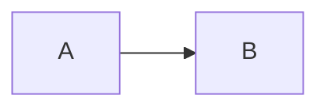

# Optional features and extensions

Carve documents remain readable when an optional feature is unavailable. The source still parses; only the richer behavior may be missing. Use this page to choose features for an application and to understand what a reader sees without them.

Carve 0.2 keeps core syntax fixed. An extension claims an existing core form after core parsing: an inline `:name[content]`, a named div (`::: name`), or a fenced code block by its language. It cannot add a new delimiter or line shape. A form that no registered extension claims stays the core node the parser built.

For the API rules used to implement an extension, read the [extension contract](./extension-contract). For a complete worked example, see [Write an extension](./extension-tutorial).

## What is available {#feature-tiers-quick-reference}

| Availability | What it means | Default |
|---|---|---|
| **Core syntax** | Every conforming Carve processor supports it, including headings, links, lists, tables, captions, footnotes, math, and `@mention` / `#tag` recognition. | On |
| **Default-on behavior** | Every reference processor supplies it, but applications may disable it. Smart typography is the main case; the `smartTypography` render option turns it off. | On |
| **Standard extension** | The specification defines its source form, fallback and output, and the reference engines ship it, but a host registers it explicitly. | Off |
| **Processor feature** | A host supplies file access, as with `{{ path }}` includes. Check that processor's settings. | Off without a file resolver |
| **Application extension** | A particular implementation or host supplies it, through the same extension interface. Check that application. | Off |

These are availability groups, not quality levels. "Optional" means that a document has a useful fallback when the feature is not enabled. The standard extensions and the extension interface itself are provisional in Carve 0.2: they may change in a 0.2.x release, so pin the engine revision you build against.

## Standard extensions

The JavaScript reference engine ships every standard extension in `@markup-carve/carve/extensions`. The command line registers them by name with `--extensions`.

| Family | Source form | Names for `--extensions` | Factory | Core output without the extension |
|---|---|---|---|---|
| Details | `::: details "Title"` | `carve.details` | `details()` | A div with a title paragraph |
| Spoiler | `:spoiler[...]`, `::: spoiler` | `carve.spoiler`, `carve.spoilerBlock` | `spoiler()` | A visible span or titled div |
| Tabs | `:::: tabs` of `::: tab "Title"` | `carve.tabs`, `carve.tab` | `tabsExtensions`, `standardTabsRenderer()` | Each panel as a titled div |
| Code groups | `::: code-group` of code blocks | `carve.codeGroup` | `codeGroup()` | The code blocks inside a div |
| List tables | `::: list-table` of nested lists | `carve.listTable` | `listTable()` | The nested list |
| Diagrams | fences `mermaid`, `chart`, `d2`, `dot`, `graphviz`, `plantuml`, `puml`, `vega-lite`, `wavedrom`, `abc` | `carve.fencedRender.<language>` | `mermaid()`, `chart()`, ..., `presets()` | The code block |
| Math blocks | fence `math` | `carve.mathBlock` | `mathBlock()` | The code block |
| SVG images | fences `img`, `image` | `carve.imgFence.img`, `carve.imgFence.image` | `imgFence()` | The code block |
| Wiki links | `:wiki[Page]`, `:wiki[Page\|Text]` | `carve.wiki` | `wikilinks()` | `Page\|Text` as plain text |
| Citations | `:cite[key]`, `::: references` | `carve.cite` | `citations()` | The key as text, the entries as a description list |
| Color swatches | `:color[value]` | `carve.colorSwatch` | `colorSwatch()` | The value as text (a hex value reads as a `#tag`) |
| Semantic spans | `[text]{samp}`, `{var}`, `{cite}`, `{dfn}` | `carve.semanticSpan` | `semanticSpan()` | A span with the attribute |
| Code callouts | `<n>` at line ends, `<n> text` below | `carve.codeCallouts` | `codeCallouts()` | The marks stay in the code and text |
| Glossary | `:term[word]`, `::: glossary` | `carve.glossary` | `glossary()` | The word as text, the entries as a description list |
| Index | `:index[term]`, `::: index` | `carve.index` | `index()` | The term as text, and an empty div |
| Navigation | headings and links | `carve.toc`, `carve.tocPlacement`, `carve.headingNumbers`, `carve.headingPermalinks`, `carve.headingReference` | `tableOfContents()`, `tocPlacement()`, `headingNumbers()`, `headingPermalinks()`, `headingReference()` | Plain headings and links |
| Links | bare URLs, external links | `carve.autolink`, `carve.externalLinks` | `autolink()`, `externalLinks()` | Plain text and plain links |
| Typography | `"quotes"` with smart typography | `carve.smartQuotes` | `smartQuotes()` | English quote glyphs |
| Tab characters | tabs in code | `carve.tabNormalize` | `tabNormalize()` | Tabs kept as written |

The library also ships host helpers that are not catalog rows and so have no `--extensions` name: `defaultAttributes(map)` adds attributes to every node of a type, `inlineFootnotesToParentheses()` turns `^[...]` notes into parenthesized text, `linkPolicy(options)` turns links into plain text by scheme or domain, and `fencedRender(options)` builds a diagram-style extension for any fence language.

## Enable a feature

Extensions are registered on a processor or renderer. The exact names differ by language, but the workflow is the same:

1. Create the extension or choose a supplied one.
2. Register it when creating the processor.
3. Render a representative document, and inspect its fallback with the extension disabled.
4. For interactive output, also test static mode and the [static-output fallback](./graceful-degradation).

On the command line, pass the names as a JSON list. `--extension-options` sets the renderer options of a standard extension, keyed by name:

```sh
npx carve render --extensions '["carve.tabs","carve.tab"]' --extension-options '{"carve.tabs":{"mode":"aria"}}' doc.crv
```

In JavaScript, each factory returns a bundle `{ extensions, renderers }`, and some add `transforms`. `withExtensions` merges bundles. Two extensions that claim the same form cannot be registered together: the render fails with `duplicate claim`. A bundle with `transforms` goes through `renderWithDocumentTransforms`; `render` refuses a `transforms` option. Navigation and link factories return a single definition that goes into the `extensions` list:

```js
import { renderWithDocumentTransforms } from '@markup-carve/carve'
import { citations, details, externalLinks, spoiler, withExtensions } from '@markup-carve/carve/extensions'

const source = `The answer :cite[doe]{locator="p. 4"} is :spoiler[42]. See [the paper](https://example.com).

::: details "Method"
We asked a computer.
:::

::: references
:: doe
: Doe, J. The Answer. 2020.
:::
`

// Bundles merge into one; a navigation extension is a single definition.
const { transforms, extensions, renderers } = withExtensions(citations(), details(), spoiler())
const output = renderWithDocumentTransforms(source, transforms, {
  extensions: [...extensions, externalLinks()],
  renderers,
})
console.log(output.html)
```

The program prints:

```html
<p>The answer [<a href="#ref-doe" data-cite-key="doe">1</a>, p. 4] is <span class="spoiler">42</span>. See <a href="https://example.com" rel="noopener noreferrer" target="_blank">the paper</a>.</p>
<details>
  <summary>Method</summary>
  <p>We asked a computer.</p>
</details>
<div class="references">
  <ol class="references">
    <li id="ref-doe">Doe, J. The Answer. 2020.</li>
  </ol>
</div>
```

The command line gives the same HTML for that source with `--extensions '["carve.cite","carve.details","carve.spoiler","carve.spoilerBlock","carve.externalLinks"]'`. Implementation-specific setup for other languages is linked from [Implementations and tooling](./ecosystem).

The examples below show each family twice: a compare block with the core output, which is what this site and any processor without the extension write, and then the output of `npx carve render` with the extension registered.

## Disclosure: details and spoilers

`details` turns a titled div into a native disclosure:

::: compare
```crv
::: details "Shipping costs"
Orders over 50 EUR ship free.
:::
```
```html
<div class="details">
  <p class="admonition-title">Shipping costs</p>
  <p>Orders over 50 EUR ship free.</p>
</div>
```
:::

```sh
npx carve render --extensions '["carve.details"]' details.crv
```

```html
<details>
  <summary>Shipping costs</summary>
  <p>Orders over 50 EUR ship free.</p>
</details>
```

A spoiler can be inline or a block. The inline form hides a few words inside a sentence; the block form hides whole paragraphs behind a disclosure. Both use existing core forms, and a host registers the two names together:

::: compare
```crv
The killer is :spoiler[the butler] all along.

::: spoiler "Ending"
The butler did it.
:::
```
```html
<p>The killer is <span class="ext-spoiler">the butler</span> all along.</p>
<div class="spoiler">
  <p class="admonition-title">Ending</p>
  <p>The butler did it.</p>
</div>
```
:::

```sh
npx carve render --extensions '["carve.spoiler","carve.spoilerBlock"]' spoiler.crv
```

```html
<p>The killer is <span class="spoiler">the butler</span> all along.</p>
<details class="spoiler">
  <summary>Ending</summary>
  <p>The butler did it.</p>
</details>
```

Carve only marks the hidden content. The blur and the click to reveal come from the host's CSS. A spoiler block without a title gets `<summary>Spoiler</summary>`. In static mode nothing stays hidden: `details` writes `<details open>`, and the spoiler adds the `spoiler-revealed` class:

```sh
npx carve render --mode static --extensions '["carve.spoiler","carve.spoilerBlock"]' spoiler.crv
```

```html
<p>The killer is <span class="spoiler spoiler-revealed">the butler</span> all along.</p>
<section class="spoiler spoiler-revealed">
  <h3 class="spoiler-title">Ending</h3>
  <p>The butler did it.</p>
</section>
```

Without the extension, the core keeps a class on each form, `<span class="ext-spoiler">` and `<div class="spoiler">`, so the text stays visible.

## Tabs and code groups

Tabs group titled `tab` divs into one set of panels. The group is claimed only when every block in it is a `::: tab`:

::: compare
```crv
:::: tabs
::: tab "npm"
Run `npm install`.
:::

::: tab "pnpm"
Run `pnpm add`.
:::
::::
```
```html
<div class="tabs">
  <div class="tab">
    <p class="admonition-title">npm</p>
    <p>Run <code>npm install</code>.</p>
  </div>
  <div class="tab">
    <p class="admonition-title">pnpm</p>
    <p>Run <code>pnpm add</code>.</p>
  </div>
</div>
```
:::

```sh
npx carve render --extensions '["carve.tabs","carve.tab"]' tabs.crv
```

```html
<div class="tabs" role="group" aria-label="Tabs"><input type="radio" name="tabs-1" id="tabs-1-0" checked><label for="tabs-1-0">npm</label><input type="radio" name="tabs-1" id="tabs-1-1"><label for="tabs-1-1">pnpm</label><div class="tab-panel" role="group" aria-label="npm"><p>Run <code>npm install</code>.</p></div><div class="tab-panel" role="group" aria-label="pnpm"><p>Run <code>pnpm add</code>.</p></div></div>
```

The default `css` mode uses radio inputs and needs no script. The `aria` mode writes WAI-ARIA tab buttons and panels; the host ships the script that switches them:

```sh
npx carve render --extensions '["carve.tabs","carve.tab"]' --extension-options '{"carve.tabs":{"mode":"aria"}}' tabs.crv
```

```html
<div class="tabs" role="tablist" aria-label="Tabs"><button type="button" role="tab" id="tabs-1-0" aria-selected="true" aria-controls="tabs-1-0-panel">npm</button><button type="button" role="tab" id="tabs-1-1" aria-selected="false" aria-controls="tabs-1-1-panel" tabindex="-1">pnpm</button><div class="tab-panel" role="tabpanel" id="tabs-1-0-panel" aria-labelledby="tabs-1-0"><p>Run <code>npm install</code>.</p></div><div class="tab-panel" role="tabpanel" id="tabs-1-1-panel" aria-labelledby="tabs-1-1" hidden><p>Run <code>pnpm add</code>.</p></div></div>
```

A code group does the same for code blocks. It claims a div only when its body holds nothing but code blocks. The label of each panel is the block's bracket label, else its quoted title, else its language:

::: compare
````crv
::: code-group
```js [JavaScript]
console.log(1)
```

```py [Python]
print(1)
```
:::
````
```html
<div class="code-group">
  <pre><code class="language-js">console.log(1)
</code></pre>
  <pre><code class="language-py">print(1)
</code></pre>
</div>
```
:::

```sh
npx carve render --extensions '["carve.codeGroup"]' codegroup.crv
```

```html
<div class="code-group" role="group" aria-label="Code examples"><input type="radio" name="codegroup-1" id="codegroup-1-tab-1" class="code-group-radio" checked><label for="codegroup-1-tab-1" class="code-group-label">JavaScript</label><input type="radio" name="codegroup-1" id="codegroup-1-tab-2" class="code-group-radio"><label for="codegroup-1-tab-2" class="code-group-label">Python</label><div class="code-group-panel" role="group" aria-label="JavaScript"><pre><code class="language-js">console.log(1)
</code></pre></div><div class="code-group-panel" role="group" aria-label="Python"><pre><code class="language-py">print(1)
</code></pre></div></div>
```

## List tables

A list table builds a table from nested lists, so a cell can hold block content. Each item of the outer list is a row, and each item of its inner list is a cell. `header-rows`, `header-cols` and `footer-rows` place head and foot cells; the div's title becomes the caption. Inside a row, an item that holds only `<` joins its cell to the cell on its left, and one that holds only `^` joins it to the cell above.

::: compare
```crv
{header-rows=1}
::: list-table "Sizes"
- - Model
  - Sizes
- - Trail
  - 38 to 46
- - Road
  - 40 to 44
:::
```
```html
<div class="list-table" header-rows="1">
  <p class="admonition-title">Sizes</p>
  <ul>
    <li>
      <ul>
        <li>Model</li>
        <li>Sizes</li>
      </ul>
    </li>
    <li>
      <ul>
        <li>Trail</li>
        <li>38 to 46</li>
      </ul>
    </li>
    <li>
      <ul>
        <li>Road</li>
        <li>40 to 44</li>
      </ul>
    </li>
  </ul>
</div>
```
:::

```sh
npx carve render --extensions '["carve.listTable"]' listtable.crv
```

```html
<table>
  <caption>Sizes</caption>
  <thead>
    <tr><th scope="col">Model</th><th scope="col">Sizes</th></tr>
  </thead>
  <tbody>
    <tr><td>Trail</td><td>38 to 46</td></tr>
    <tr><td>Road</td><td>40 to 44</td></tr>
  </tbody>
</table>
```

## Diagrams and math blocks

The diagram extensions claim a fence by its language and write the source for a client library to draw. `mermaid` writes a `<pre class="mermaid">`; `chart` and `vega-lite` write a `<div>` around a `<script type="application/json">`. `presets()` registers all of them at once.

::: compare
````crv

````
```html
<pre><code class="language-mermaid">graph LR
  A --&gt; B
</code></pre>
```
:::

```sh
npx carve render --extensions '["carve.fencedRender.mermaid"]' mermaid.crv
```

```html
<pre class="mermaid" role="img" aria-label="mermaid">graph LR
  A --> B</pre>
```

The engine makes no network call and draws nothing itself. In static mode a diagram has a renderer only where the host gives it a build function (`mermaid({ build })`); without one, the plain code block is written and the engine reports it:

```sh
npx carve render --mode static --extensions '["carve.fencedRender.mermaid"]' mermaid.crv
# stderr: mermaid.crv:1:1: warning extension-fallback-rendered Rendered the fallback of the extension "carve.fencedRender.mermaid", which has no matching renderer
```

```html
<pre><code class="language-mermaid">graph LR
  A --&gt; B
</code></pre>
```

A `math` fence becomes display math in the form KaTeX and MathJax read. Core display math (`$$...$$`) needs no extension; the fence is for authors who prefer a block:

::: compare
````crv
```math
\int_0^1 x^2 \, dx = \frac{1}{3}
```
````
```html
<pre><code class="language-math">\int_0^1 x^2 \, dx = \frac{1}{3}
</code></pre>
```
:::

```sh
npx carve render --extensions '["carve.mathBlock"]' math.crv
```

```html
<div class="math display" role="math">\[\int_0^1 x^2 \, dx = \frac{1}{3}\]</div>
```

## SVG image fences

`imgFence` claims `img` and `image` fences whose body is SVG source. Its sanitizer removes scripts, event attributes, external references and foreign content, then writes the result as a `data:` URL on one ``. The `alt` attribute supplies the alt text; without it the image gets `alt=""`. In this example the `onclick` attribute is removed:

::: compare
````crv
{alt="A blue dot"}
```img
<svg viewBox="0 0 10 10"><circle cx="5" cy="5" r="4" fill="blue" onclick="alert(1)"/></svg>
```
````
```html
<pre alt="A blue dot"><code class="language-img">&lt;svg viewBox="0 0 10 10"&gt;&lt;circle cx="5" cy="5" r="4" fill="blue" onclick="alert(1)"/&gt;&lt;/svg&gt;
</code></pre>
```
:::

```sh
npx carve render --extensions '["carve.imgFence.img","carve.imgFence.image"]' img.crv
```

```html

```

An SVG the sanitizer cannot reduce to a safe image is not written: the renderer writes the code block instead and reports the failure. In Carve 0.1 the `img` fence was core syntax; in 0.2 it is this extension.

## Wiki links, citations, swatches and semantic spans

`:wiki[Page]` links to a page by name. In `:wiki[Page|Text]` the part after `|` is the display text, which is also the fallback. The default URL is a lowercase hyphen slug; `wikilinks({ urlGenerator })` replaces it:

::: compare
```crv
See :wiki[Main Page|the home page] and :wiki[Setup].
```
```html
<p>See <span class="ext-wiki">Main Page|the home page</span> and <span class="ext-wiki">Setup</span>.</p>
```
:::

```sh
npx carve render --extensions '["carve.wiki"]' wiki.crv
```

```html
<p>See <a href="main-page" class="wikilink" data-wikilink="Main Page">the home page</a> and <a href="setup" class="wikilink" data-wikilink="Setup">Setup</a>.</p>
```

`:cite[key]` cites an entry of a `references` or `bibliography` div, written as a description list with the key as the term. A locator is an attribute, and `:cite[a; b]` names several keys. The default mode writes numbers; `citations({ mode: 'author-date' })` writes author and year, and `citations({ bibliography })` takes CSL-JSON entries from the host:

::: compare
```crv
Carve borrows from Djot :cite[macfarlane]{locator="p. 4"}.

::: references
:: macfarlane
: MacFarlane, J. Djot. 2022.
:::
```
```html
<p>Carve borrows from Djot <span class="ext-cite" locator="p. 4">macfarlane</span>.</p>
<div class="references">
  <dl>
    <dt>macfarlane</dt>
    <dd>MacFarlane, J. Djot. 2022.</dd>
  </dl>
</div>
```
:::

```sh
npx carve render --extensions '["carve.cite"]' cite.crv
```

```html
<p>Carve borrows from Djot [<a href="#ref-macfarlane" data-cite-key="macfarlane">1</a>, p. 4].</p>
<div class="references">
  <ol class="references">
    <li id="ref-macfarlane">MacFarlane, J. Djot. 2022.</li>
  </ol>
</div>
```

`:color[value]` shows a swatch next to a CSS color. A value that is not a color writes the fallback text:

::: compare
```crv
The brand color is :color[#ff6600].
```
```html
<p>The brand color is <span class="ext-color"><span class="tag"><strong>#ff6600</strong></span></span>.</p>
```
:::

```sh
npx carve render --extensions '["carve.colorSwatch"]' color.crv
```

```html
<p>The brand color is <span class="swatch"><span class="swatch-chip" style="background-color:#ff6600"></span> #ff6600</span>.</p>
```

`semanticSpan` turns the span keys `samp`, `var`, `cite` and `dfn` into their HTML elements. The core keys `abbr`, `time` and `kbd` need no extension:

::: compare
```crv
Type [ls -la]{samp} and set [n]{var} to 3.
```
```html
<p>Type <span samp="">ls -la</span> and set <span var="">n</span> to 3.</p>
```
:::

```sh
npx carve render --extensions '["carve.semanticSpan"]' semantic.crv
```

```html
<p>Type <samp>ls -la</samp> and set <var>n</var> to 3.</p>
```

## Code callouts

`codeCallouts` claims a code block whose lines end in `<n>` together with the paragraph of `<n> text` lines directly below it:

::: compare
````crv
```js
const a = 1 <1>
console.log(a) <2>
```

<1> Declares the value.
<2> Prints it.
````
```html
<pre><code class="language-js">const a = 1 &lt;1&gt;
console.log(a) &lt;2&gt;
</code></pre>
<p>&lt;1&gt; Declares the value.
&lt;2&gt; Prints it.</p>
```
:::

```sh
npx carve render --extensions '["carve.codeCallouts"]' callouts.crv
```

```html
<pre><code class="language-js">const a = 1 <b class="callout" data-callout="1">1</b>
console.log(a) <b class="callout" data-callout="2">2</b>
</code></pre>
<ol class="callouts"><li value="1">Declares the value.</li><li value="2">Prints it.</li></ol>
```

## Glossary and index

`:term[word]` links a word to its entry in a `glossary` div, whose description list holds the definitions:

::: compare
```crv
A :term[lemma] is a proven statement.

::: glossary
:: lemma
: A statement proven on the way to a larger result.
:::
```
```html
<p>A <span class="ext-term">lemma</span> is a proven statement.</p>
<div class="glossary">
  <dl>
    <dt>lemma</dt>
    <dd>A statement proven on the way to a larger result.</dd>
  </dl>
</div>
```
:::

```sh
npx carve render --extensions '["carve.glossary"]' glossary.crv
```

```html
<p>A <a href="#gloss-lemma" class="term">lemma</a> is a proven statement.</p>
<div class="glossary">
  <dl class="glossary">
    <dt id="gloss-lemma">lemma</dt>
    <dd>A statement proven on the way to a larger result.</dd>
  </dl>
</div>
```

`:index[term]` marks a place for the index. With the extension the marker shows no text, so the word also belongs in the sentence; without it the term appears as plain text. An empty `index` div is replaced by the list of terms with back-links. `index({ backrefLabel })` sets the accessible label of those links:

::: compare
```crv
Quicksort :index[quicksort] sorts in place.

::: index

:::
```
```html
<p>Quicksort <span class="ext-index">quicksort</span> sorts in place.</p>
<div class="index">

</div>
```
:::

```sh
npx carve render --extensions '["carve.index"]' index.crv
```

```html
<p>Quicksort <span id="idx-quicksort-1" class="index-term"></span> sorts in place.</p>
<div class="index">
  <ul class="index">
    <li>quicksort <a href="#idx-quicksort-1" class="index-backref" aria-label="Back to quicksort">↩</a></li>
  </ul>
</div>
```

## Navigation and links

Heading numbers, permalinks and heading references change how headings and references to them are written. They count only headings at the top level of the document, not headings in quotes, divs, lists or footnotes. A heading with the class `unnumbered` gets no number:

::: compare
```crv
= Guide

== Install

== Configure

See </#Install>.
```
```html
<section id="Guide">
  <h1>Guide</h1>
  <section id="Install">
    <h2>Install</h2>
  </section>
  <section id="Configure">
    <h2>Configure</h2>
    <p>See <a href="#Install">Install</a>.</p>
  </section>
</section>
```
:::

```sh
npx carve render --extensions '["carve.headingNumbers","carve.headingPermalinks"]' headings.crv
```

```html
<section id="Guide">
  <h1><span class="section-number">1</span> Guide <a href="#Guide" class="permalink" aria-label="Permalink">¶</a></h1>
  <section id="Install">
    <h2><span class="section-number">1.1</span> Install <a href="#Install" class="permalink" aria-label="Permalink">¶</a></h2>
  </section>
  <section id="Configure">
    <h2><span class="section-number">1.2</span> Configure <a href="#Configure" class="permalink" aria-label="Permalink">¶</a></h2>
    <p>See <a href="#Install">Section 1.1 - Install</a>.</p>
  </section>
</section>
```

`headingNumbers({ crossref })` picks how a reference to a numbered heading reads: `number`, `number-title` (shown above) or `title`. `carve.toc` inserts a table of contents before the first block; `carve.tocPlacement` puts it where a `::: toc` div stands instead:

```sh
npx carve render --extensions '["carve.toc"]' headings.crv
```

```html
<nav class="toc" aria-label="Table of contents">
  <ul>
    <li><a href="#Guide">Guide</a>
      <ul>
        <li><a href="#Install">Install</a></li>
        <li><a href="#Configure">Configure</a></li>
      </ul>
    </li>
  </ul>
</nav>
<section id="Guide">
  <h1>Guide</h1>
  <section id="Install">
    <h2>Install</h2>
  </section>
  <section id="Configure">
    <h2>Configure</h2>
    <p>See <a href="#Install">Install</a>.</p>
  </section>
</section>
```

`autolink` turns bare `http`, `https` and `mailto` URLs in text into links, and `externalLinks` marks links to `http` and `https` URLs to open in a new tab:

::: compare
```crv
Visit https://example.com or read [the docs](https://example.com/docs).
```
```html
<p>Visit https://example.com or read <a href="https://example.com/docs">the docs</a>.</p>
```
:::

```sh
npx carve render --extensions '["carve.autolink","carve.externalLinks"]' links.crv
```

```html
<p>Visit <a href="https://example.com" rel="noopener noreferrer" target="_blank">https://example.com</a> or read <a href="https://example.com/docs" rel="noopener noreferrer" target="_blank">the docs</a>.</p>
```

## Typography

Smart typography is on by default and writes English quote glyphs. `smartQuotes` picks the glyphs of a locale; a locale without its own glyphs uses those of its language, else English:

::: compare
```crv
Er sagte "hallo" und ging.
```
```html
<p>Er sagte “hallo” und ging.</p>
```
:::

```sh
npx carve render --extensions '["carve.smartQuotes"]' --extension-options '{"carve.smartQuotes":{"locale":"de"}}' quotes.crv
```

```html
<p>Er sagte „hallo“ und ging.</p>
```

## Unknown extension names

The inline form `:name[text]` and the block form `::: name` are core syntax. If no extension claims `name`, Carve writes a generic span or container. This keeps the content present and gives applications a stable place to add behavior.

::: compare
```crv
:product[Trail shoes]{sku=TR-42}

::: product-card
Trail shoes come in three sizes.
:::
```
```html
<p><span class="ext-product" sku="TR-42">Trail shoes</span></p>
<div class="product-card">
  <p>Trail shoes come in three sizes.</p>
</div>
```
:::

An application can later attach meaning to `product` and `product-card`; a plain processor still keeps their words and attributes.

## What a document carries

A qualified extension has a name such as `org.example.badge` and an exact version. A producer declares it at the document root or envelope. Its node has a core fallback of the same role. A reader that does not know an optional extension keeps the declaration and uses the fallback; a reader refuses an unknown required extension. Without a matching renderer, HTML uses the fallback and reports `extension-fallback-rendered`. An extension renderer is trusted code: it should use the host's escaping and URL helpers for anything authored.

## Choosing between document syntax and an extension

Prefer core syntax when the meaning belongs in the document and should work in every processor. Prefer an extension when the behavior needs external data, application state, a third-party renderer, or an interactive interface.

Good extension behavior has three properties:

- the source remains understandable without the extension;
- disabling the extension does not silently discard authored words;
- unavailable interaction degrades to useful static output.

For the reasons behind these boundaries, see [Feature design notes](./native-features-analysis).

<a id="_9-headingnumbers-tier-3"></a>
<a id="_6-1-data-source"></a>

## Changed extension catalog

Older documentation linked to heading-number and bibliography integrations at these anchors. Bibliographies are now part of the citation extension: a `bibliography` or `references` div holds the entries, and `citations({ bibliography })` adds CSL-JSON data from the host. Heading numbers are the `headingNumbers()` navigation extension described above. The 0.1 tier table does not classify 0.2 features; the availability groups at the top of this page replace it.

## Technical reference

The [extension contract](./extension-contract) defines matching, transforms, rendering, fallbacks and writing. It is intended for extension and engine authors rather than readers choosing a feature.

**Specification (external):** [registration and matching](https://github.com/markup-carve/carve/blob/main/spec/0.2/extensions.md#registration-and-matching) (C2-X-001 to C2-X-014), [rendering and fallbacks](https://github.com/markup-carve/carve/blob/main/spec/0.2/extensions.md#resolution-rendering-and-equality), [standard extension source forms](https://github.com/markup-carve/carve/blob/main/spec/0.2/extensions.md#standard-extension-source-forms) (C2-X-057 to C2-X-060), [standard extensions of the 0.1 catalog](https://github.com/markup-carve/carve/blob/main/spec/0.2/extensions.md#standard-extensions-of-the-01-catalog) (C2-X-061 to C2-X-078), [standard tabs](https://github.com/markup-carve/carve/blob/main/spec/0.2/extensions.md#standard-extension-tabs), the catalog data [`data/extensions.json`](https://github.com/markup-carve/carve/blob/main/spec/0.2/data/extensions.json), [AST extension nodes](https://github.com/markup-carve/carve/blob/main/spec/0.2/ast.md#extension-nodes-foreign-data-and-resources), the command-line flags `--extensions` and `--extension-options` in [tooling](https://github.com/markup-carve/carve/blob/main/spec/0.2/tooling.md) (C2-T-010), and [extension status](https://github.com/markup-carve/carve/blob/main/spec/0.2/STATUS.md).
