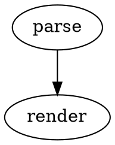

# Static rendering recipes

[Static mode](./graceful-degradation.md) flattens interaction on its own: tabs
become titled sections, disclosures open, spoilers are revealed. The
**client-rendered visuals** (diagrams and math blocks) need more. Carve 0.2 does
not ship a Graphviz, Mermaid, MathJax or KaTeX conversion step, and the engine
makes no network call. The host passes a **build function** to the diagram or
math extension, and the engine embeds what it returns instead of the source.
The specification defines that contract; this page gives tested recipes for the
build functions, the render options a static build needs, and the sanitizer
setting that silently eats images.

## Render a document

```sh
carve render --mode static --strict-losses document.crv > document.html
```

`--strict-losses` fails on any render loss that is not allowed and writes no
HTML for the affected file. A missing build function is such a loss. With this
document:

````crv
= Release notes



```math
\sum_{i=1}^n i = \frac{n(n+1)}{2}
```
````

the command line can register the two extensions, but not their build
functions, which are host code. Both blocks fall back to source, and the strict
render fails:

```text
$ carve render --mode static --strict-losses --extensions '["carve.fencedRender.dot","carve.mathBlock"]' document.crv > document.html
carve[render-loss]: document.crv: 2 render losses under --strict-losses
document.crv:3:1: warning extension-fallback-rendered Rendered the fallback of the extension "carve.fencedRender.dot", which has no matching renderer
document.crv:7:1: warning extension-fallback-rendered Rendered the fallback of the extension "carve.mathBlock", which has no matching renderer
```

The exit status is 1 and `document.html` is empty. To accept source fallbacks,
add `--allow-loss extension-fallback-rendered`. To keep a machine-readable
record, add `--report-losses losses.json`, which writes each diagnostic with its
code, line, column and tree path. See [validation](./validation.md).

## Build functions

Every diagram fence of the standard catalog (`mermaid`, `dot`, `graphviz`,
`plantuml`, `d2`, `chart`, `vega-lite`, `wavedrom`, `abc`) and the `math` fence
are extensions. In carve-js each is a function in
`@markup-carve/carve/extensions` that takes an optional `build`:

- `graphviz({ build: (source) => html })`, and the same for `mermaid`,
  `plantuml`, `d2` and the other presets; `fencedRender({ language, build })`
  for any other fence word.
- `mathBlock({ build: (tex, display) => html })` for `math` fences.
- `presets({ mermaid: build, graphviz: build, ... })` registers every diagram
  preset at once, keyed by its CSS class as in 0.1.

Each returns a bundle of `extensions` and `renderers`; spread it into the render
options, and merge several with `withExtensions(...)`. The 0.1 `renderers` map
keyed by fence word is gone: `renderers` is now keyed by qualified extension
name (`carve.fencedRender.dot`), and the bundles fill it for you. carve-php and
carve-rs expose the same build hook under their own names; check the engine's
documentation.

A build function receives the fence body without its last line break and
returns self-contained HTML, usually an inline `<svg>` or an
``. The engine wraps it in the extension's element (for
Graphviz, `<div class="graphviz" role="img" aria-label="graphviz">`) and writes
it unchanged, so the build function is trusted code. **If it is absent, the
static path writes the source as a code block; if it throws, the engine writes
the same fallback and reports the failure.** A build function is an
enhancement, never a requirement.

## Recipes

### Graphviz with the local `dot` binary: the model recipe

`dot` is local, fast, and writes SVG. This is the shape every build function
should follow: render, embed, and let a failure fall back to source.

```js
import { readFileSync } from 'node:fs'
import { execFileSync } from 'node:child_process'
import katex from 'katex'
import { renderWithDiagnostics } from '@markup-carve/carve'
import { graphviz, mathBlock, withExtensions } from '@markup-carve/carve/extensions'

const dot = (src) => {
  try {
    return execFileSync('dot', ['-Tsvg'], { input: src, encoding: 'utf8', timeout: 10000, stdio: ['pipe', 'pipe', 'ignore'] })
      .replace(/^[\s\S]*?(?=<svg)/, '') // drop the XML prolog and doctype
  } catch {
    throw new Error('dot failed') // the engine writes the fallback code block
  }
}

const bundle = withExtensions(
  graphviz({ build: dot }),
  mathBlock({ build: (tex, display) => katex.renderToString(tex, { displayMode: display, output: 'mathml' }) }),
)

const { html, diagnostics } = renderWithDiagnostics(readFileSync(process.argv[2], 'utf8'), { ...bundle, mode: 'static' })
console.log(html)
console.error(diagnostics.map((d) => d.code))
```

Run on the document above, it prints no diagnostics (`[]`) and this HTML
(the SVG is shortened here):

```html
<section id="Release-notes">
  <h1>Release notes</h1>
  <div class="graphviz" role="img" aria-label="graphviz"><svg width="74pt" height="116pt"
 viewBox="0.00 0.00 74.29 116.00" xmlns="http://www.w3.org/2000/svg" xmlns:xlink="http://www.w3.org/1999/xlink">
...
</svg>
</div>
  <div class="math display" role="math"><span class="katex"><math xmlns="http://www.w3.org/1998/Math/MathML" display="block"><semantics>...<annotation encoding="application/x-tex">\sum_{i=1}^n i = \frac{n(n+1)}{2}</annotation></semantics></math></span></div>
</section>
```

With a syntax error in the DOT source, `dot` exits non-zero, the build function
throws, and the reader still gets the source:

```text
<pre><code class="language-dot">digraph { a -&gt; 
</code></pre>
[ 'extension-renderer-failed', 'extension-fallback-rendered' ]
```

The command never comes from the document: the build function runs a fixed
binary with fixed arguments and passes the source on standard input. Do not let
document text choose a command line or a remote endpoint.

### Mermaid and other async tools: pre-render, then look up

Build functions are synchronous. `mmdc` (`@mermaid-js/mermaid-cli`) renders
Mermaid locally but drives a headless browser, and an HTTP service such as a
self-hosted [kroki](https://kroki.io) is asynchronous too. For those,
**pre-render in your build step**: collect the diagram sources from the tree,
render them, and give the engine a build function that only looks the result
up. Do not block the render call on a network request.

This runnable version uses `dot` as the async tool; for Mermaid, swap the
`execFile` call for `mmdc` or your kroki request and the `graphviz` preset for
`mermaid`:

```js
import { readFileSync } from 'node:fs'
import { execFile } from 'node:child_process'
import { promisify } from 'node:util'
import { parse, renderWithDiagnostics } from '@markup-carve/carve'
import { graphviz } from '@markup-carve/carve/extensions'

const run = promisify(execFile)
const source = readFileSync(process.argv[2], 'utf8')

// 1. Collect the diagram sources from the tree.
const sources = new Set()
const walk = (node) => {
  if (node.type === 'code_block' && ['dot', 'graphviz'].includes(node.syntax)) sources.add(node.value.replace(/\n$/, ''))
  for (const child of node.children ?? []) walk(child)
}
walk(parse(source))

// 2. Render them with the async tool, before the render call.
const images = new Map()
await Promise.all([...sources].map(async (src) => {
  const child = run('dot', ['-Tsvg'], { timeout: 10000 })
  child.child.stdin.end(src)
  const { stdout } = await child
  images.set(src, stdout.slice(stdout.indexOf('<svg')))
}))

// 3. The synchronous build function only looks the result up.
const bundle = graphviz({
  build: (src) => {
    if (!images.has(src)) throw new Error('not pre-rendered')
    return images.get(src)
  },
})
const { html, diagnostics } = renderWithDiagnostics(source, { ...bundle, mode: 'static' })
console.log(html.slice(0, 160))
console.log(diagnostics.map((d) => d.code))
```

```text
<section id="Release-notes">
  <h1>Release notes</h1>
  <div class="graphviz" role="img" aria-label="graphviz"><svg width="74pt" height="116pt"
 viewBox="0.00 0
[]
```

### Math blocks: KaTeX on the server

For static HTML, KaTeX renders TeX to MathML in-process, with no external call.
The Graphviz recipe above already registers it:

```js
mathBlock({ build: (tex, display) => katex.renderToString(tex, { displayMode: display, output: 'mathml' }) })
```

This covers `math` fences only. **Core math** (`` $`...` `` and
`` $$`...` ``) has no build-time renderer in 0.2: static mode writes the same
TeX-delimited `math` span as interactive mode.

::: compare
```crv
Inline $`e = mc^2` and display:

$$`\sum_{i=1}^n i`
```
```html
<p>Inline <span class="math inline" role="math">\(e = mc^2\)</span> and display:</p>
<p><span class="math display" role="math">\[\sum_{i=1}^n i\]</span></p>
```
:::

A site that needs typeset core math without client scripts post-processes the
HTML: find each `span.math`, strip the `\(...\)` or `\[...\]` delimiters, and
replace the span's content with KaTeX output.

For **PDF via dompdf**, MathML and KaTeX's CSS do not lay out reliably. Render
with MathJax to SVG and rasterize, or accept a PNG, and document this trade-off
for your users instead of assuming the HTML recipe works in print.

## Choosing a renderer

| Construct | Recommended (local, no external service) | Quick (external service) |
| --- | --- | --- |
| Graphviz / DOT | the `dot` binary (`-Tsvg` / `-Tpng`); prefer this | - |
| Mermaid | `@mermaid-js/mermaid-cli` (`mmdc`); needs a headless browser | a self-hosted kroki |
| Charts | a chart library in a headless renderer, or pre-export | a self-hosted kroki (Vega-Lite) |
| Math blocks (HTML target) | KaTeX or MathJax on the server, to MathML or SVG | - |
| Math (PDF via dompdf) | MathJax to SVG, then rasterize | a LaTeX-to-PNG service |

Two rules of thumb:

- **Prefer local renderers.** `dot` and KaTeX run with no network. External
  services ship your document content to a third party, a privacy and abuse
  concern for any hosted or public tool. If you use kroki, self-host it; for
  math, prefer KaTeX over a public PNG service.
- **Match the target.** For static HTML (browser, email), server-side KaTeX or
  MathJax to MathML or SVG is crisp and accessible. For PDF via dompdf, MathML
  and CSS support is weak, so a rasterized image is more reliable. The SVG path
  is the principled one, the raster path the pragmatic one.

## Sanitizers and `data:` image URIs

A build function often returns ``, and the
standard `imgFence` extension writes SVG fences as
``. If you run the static HTML through a
sanitizer **after** rendering, check what it does with those URLs, or the
picture can vanish while its caption survives:

- **HTML Purifier (PHP)** removes them by default: its `URI.AllowedSchemes`
  default is `http`, `https`, `mailto`, `ftp`, `nntp`, `news` and `tel`, and an
  `` without a valid `src` is dropped. Allow `data`:
  `$config->set('URI.AllowedSchemes', ['http' => true, 'https' => true, 'mailto' => true, 'data' => true]);`.
  That brings back PNG, GIF and JPEG data URIs, but in a test with HTML Purifier
  4.18.0 an `imgFence` `data:image/svg+xml` image was still removed. For SVG, write
  the image to a file, or sanitize before rendering instead.
- **DOMPurify (JS)** keeps `data:` URIs on `` by default (its
  `DATA_URI_TAGS` list), PNG and SVG alike, even with a stricter
  `ALLOWED_URI_REGEXP`. No change is needed.

A data URI on an `` cannot run script, which is why both libraries treat
it as an image-only exception. The alternative is to write each image to a file
and reference it by path, but a data URI keeps the output self-contained, which
is the point of static mode.

## Highlight code blocks

A host passes `codeBlockRenderer(node, defaultHtml)` to the render call. It
runs once for every code block the renderer writes, in both modes, and gets the
block's `syntax` and `value` together with the default `<pre>` HTML. It returns
HTML to write in its place, or nothing to keep the default. The returned HTML is
trusted and inserted unchanged, so a highlighter must escape the code itself:

```js
import { readFileSync } from 'node:fs'
import { render } from '@markup-carve/carve'

const escape = (s) => s.replace(/&/g, '&amp;').replace(/</g, '&lt;').replace(/>/g, '&gt;')

const html = render(readFileSync('hl.crv', 'utf8'), {
  codeBlockRenderer: (node, defaultHtml) => {
    if (node.syntax !== 'js') return undefined // keep the default <pre>
    return `<pre class="highlight" data-lang="js"><code>${escape(node.value)}</code></pre>`
  },
})
console.log(html)
```

For a `hl.crv` holding one `js` fence with `const a = 1 < 2`, it prints:

```html
<pre class="highlight" data-lang="js"><code>const a = 1 &lt; 2
</code></pre>
```

A code block that a diagram or math extension claimed is not a code block any
more, so `codeBlockRenderer` sees only its fallback when that is written.

## Soft breaks for chat output

`softBreak` writes a line break inside a paragraph as a line break (`newline`,
the default), one space (`space`), or `<br>` (`br`) for output that shows source
line breaks. The command line flag is `--soft-break`:

::: compare
```crv
First line
second line
```
```html
<p>First line
second line</p>
```
:::

```text
$ carve render --soft-break space soft.crv
<p>First line second line</p>
$ carve render --soft-break br soft.crv
<p>First line<br>
second line</p>
```

## Headings under a page title

When the page template writes the document title as the `<h1>`, `headingShift`
moves every heading down by 0 to 5 levels (default 0). With `headingShift: 1`,
`=` renders as `<h2>` and `==` as `<h3>`, inside quotes, divs, list items and
expanded includes too. The command line flag is `--heading-shift`:

```text
$ carve render --heading-shift=1 shift.crv
<section id="Title">
  <h2>Title</h2>
  <section id="Part">
    <h3>Part</h3>
  </section>
</section>
```

The shift runs after includes and before any extension transform, so
`tableOfContents`, `headingPermalinks` and `headingNumbers` see the shifted
levels, and their level options name them: with a shift of 1,
`headingPermalinks({ levels: [1] })` matches no heading. Ids and
cross-references do not change. A level above 6 renders as
`<div role="heading" aria-level="7">` and reports `heading-shift-above-6` once;
a shift above 5 is refused (`option headingShift: above its maximum 5`). Under
`roundtrip` each heading carries `data-carve-source-level`, so an HTML import
gives back the authored level. The Markdown export
(`carve render --to markdown`) reads the option too and clamps a level above 6
to 6; the plain text and ANSI exports refuse it. The option replaces the 0.1
`headingLevelShift()` extension.

## A note on caching and load

Build-time renders are deterministic on their source, so **cache them keyed on
a hash of the source**, and cache the final artifact (PDF, page) too. The
pre-render recipe above is the natural place: look each source up in the cache
before calling the tool. For an external service, cache **successful** renders
only, so a transient failure retries instead of caching a fallback, and the
service is never hit twice for the same input. This also bounds the load a
public tool can put on an external renderer.

**Specification (external):** [HTML options](https://github.com/markup-carve/carve/blob/main/spec/0.2/html.md#options) (C2-H-122, C2-H-123, C2-H-168, C2-H-208); [code and raw content](https://github.com/markup-carve/carve/blob/main/spec/0.2/html.md#code-and-raw-content); [extension rendering](https://github.com/markup-carve/carve/blob/main/spec/0.2/extensions.md#resolution-rendering-and-equality) (C2-X-033 to C2-X-035, C2-X-050, C2-X-052); [diagram and math extensions](https://github.com/markup-carve/carve/blob/main/spec/0.2/extensions.md#standard-extensions-of-the-01-catalog) (C2-X-061, C2-X-071); [`imgFence`](https://github.com/markup-carve/carve/blob/main/spec/0.2/extensions.md#standard-extension-source-forms) (C2-X-059, C2-X-060); [render flags and loss handling](https://github.com/markup-carve/carve/blob/main/spec/0.2/tooling.md#carve-render).
